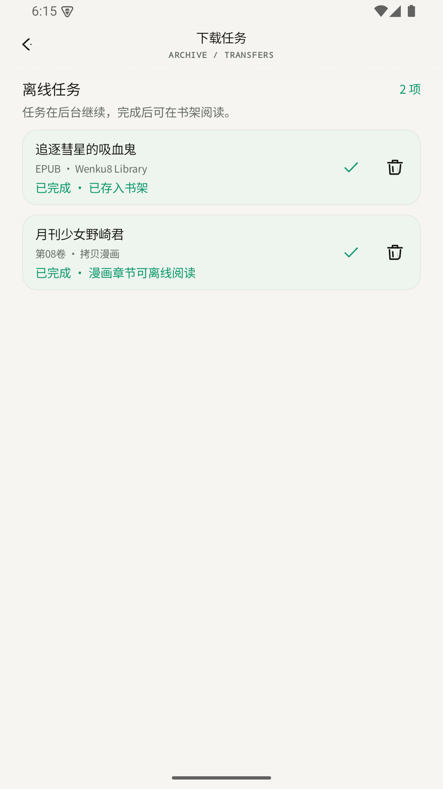
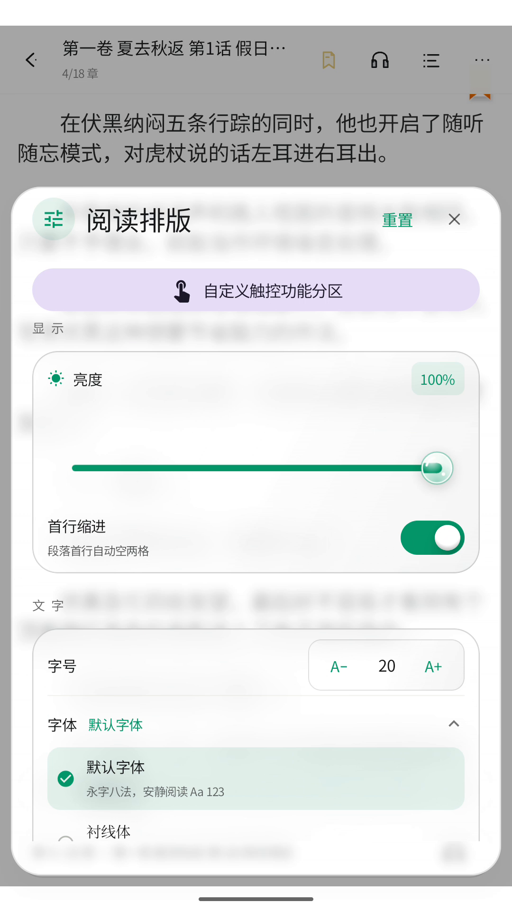
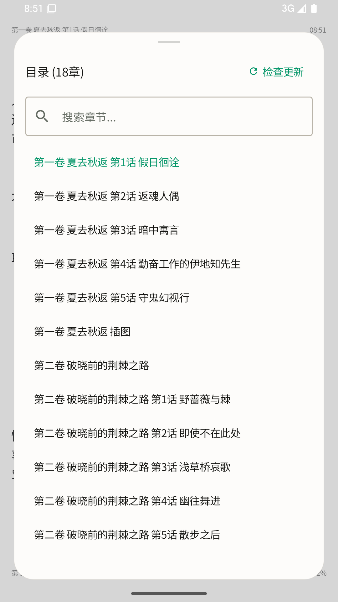
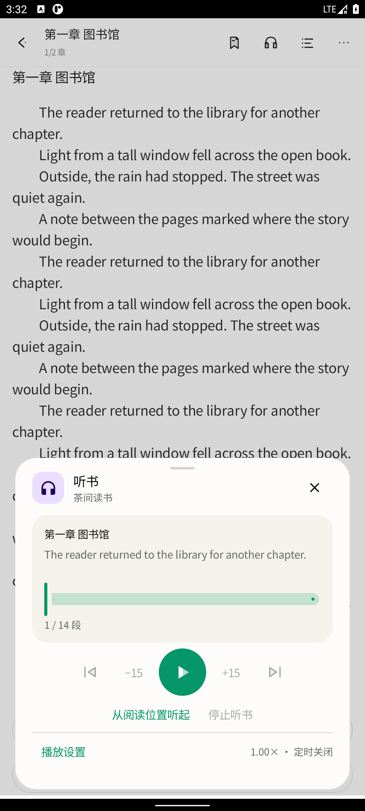
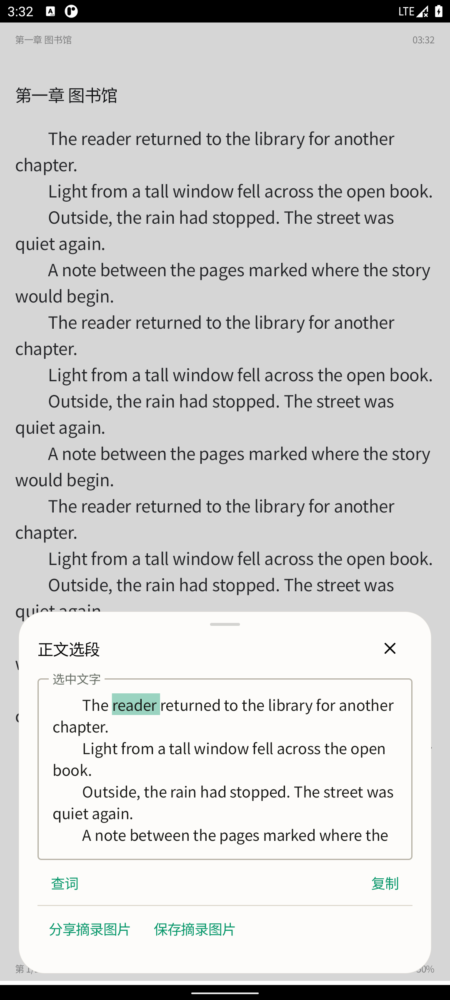
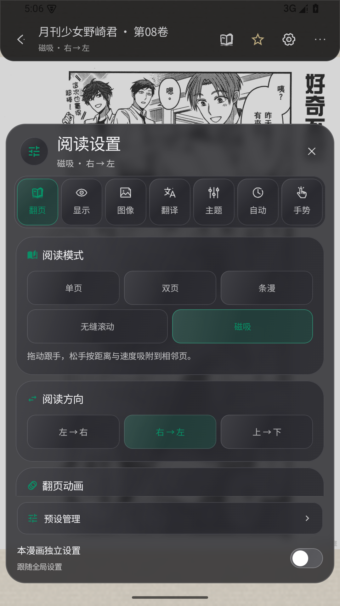
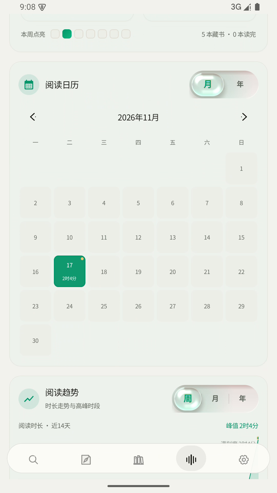
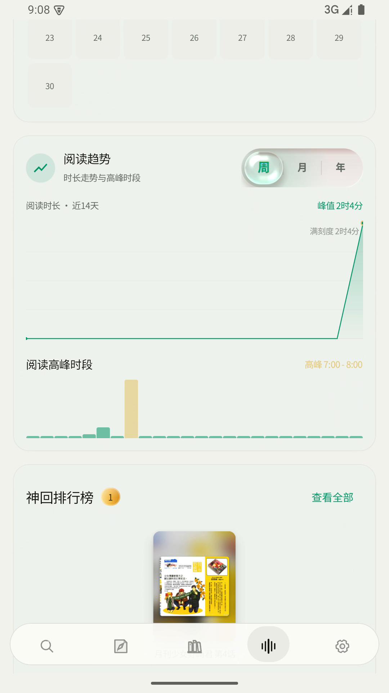
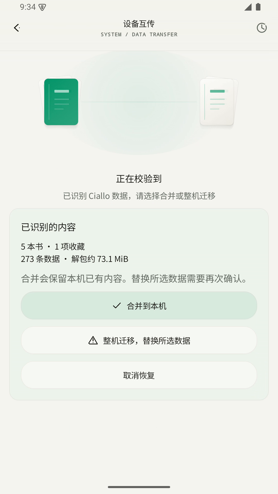
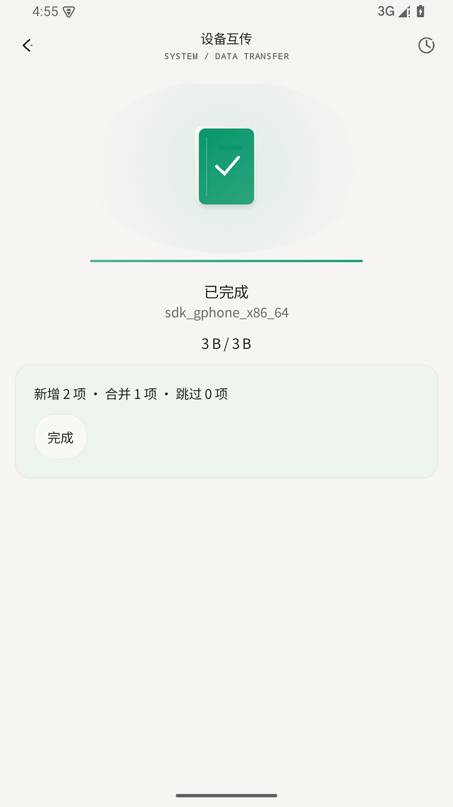

# Ciallo Reader

Android 小说、漫画与电子书阅读器。在线找书，离线续读，也能整理自己的藏书。

**[下载 APK](https://github.com/roxycon-dev/Ciallo-Reader/releases/latest)** · [产品主页](https://roxycon-dev.github.io/Ciallo-Reader/) · [English](README_EN.md)

Android 7.0+ · ARM64 · [更新记录](CHANGELOG.md)

## QQ 反馈群

**群号 `1131953681`** · 遇到 Bug 或有功能建议，欢迎进群反馈。

[1.6.10 发布说明](docs/release-1.6.10-2026-11-28.md)

[找书与书架](#找书与书架) · [小说与电子书](#小说与电子书) · [听书查词与批注](#听书查词与批注) · [漫画](#漫画) · [统计与个性化](#统计与个性化) · [内置书源](#内置书源) · [备份与互传](#备份与设备互传) · [安装与上手](#安装与上手)

## 找书与书架

<table>
<tr>
<td width="33%" align="center"> 发现页的漫画推荐</td>
<td width="33%" align="center"> 多书源搜索结果</td>
<td width="33%" align="center"> 作品详情与继续阅读</td>
</tr>
<tr>
<td width="33%" align="center"> 下载中心的已完成任务</td>
<td width="33%" align="center"> 书架网格与本地藏书</td>
<td width="33%" align="center"> 拖动浏览 3D 书架</td>
</tr>
</table>

- **搜索与发现**　书库支持小说、漫画和聚合搜索，可从历史搜索重试。用中文、日文或英文关键词搜索别名，按书源筛选。小说和漫画均可从来源提供的推荐、更新、榜单或原站分类进入。
- **收藏与进度**　收藏在线作品、切换可用书源、从最近位置续读。书架支持分类、检索、排序、列表和 3D 展示，以及开合书动效。可批量导入、整理书籍、标记读完，下载的作品也可归入自定义分类。
- **下载与离线**　按来源下载整本小说或选择漫画章节、卷。下载中心显示进度并提供暂停、恢复和重试。完成后从书架离线打开。长按任务可多选或全选清理下载记录，已入库的文件仍可从书架管理。

## 小说与电子书

<table>
<tr>
<td width="25%" align="center"> 小说字体与排版设置</td>
<td width="25%" align="center"> 小说目录与章节搜索</td>
<td width="25%" align="center"> 小说仿真翻页</td>
<td width="25%" align="center"> EPUB 竖排正文</td>
</tr>
</table>

- **还原书内排版**　标题、粗体、斜体、下划线、删除线和上下标等常见样式按格式保留。EPUB 还会读取书内链接的 CSS，以及封面、目录、插图与书籍排版方向。Markdown 和 HTML 以排版后的正文显示。
- **横排与竖排**　按书设置随原书、横排或竖排。竖排保留左右列方向、插图和阅读进度。
- **自定义阅读**　可调字体、字号、字距、行距、边距、亮度和阅读主题。提供仿真卷页、覆盖、平移、渐变、上下滚动等翻页方式。触控分区按阅读模式保存，支持设置点按和滑动动作，并在保存前试读。还支持休息提醒、目录、书签、章内或整书搜索。

| 可导入格式 | 阅读方式 |
| --- | --- |
| TXT | 自动识别常见编码与章节 |
| EPUB | 图文、目录、常见 CSS 与横竖排 |
| MOBI、AZW、AZW3、PRC | 导入可读的 Kindle/PDB/KF8 正文与支持的样式 |
| DOCX、FB2 | 渲染文字格式并识别章节 |
| Markdown、HTML、XHTML | 将标记渲染为可读正文 |
| CBZ、ZIP | 按顺序阅读压缩包中的漫画图像 |
| PDF | 按原页显示 |

## 听书查词与批注

<table>
<tr>
<td width="25%" align="center"> 听书播放器</td>
<td width="25%" align="center"> 听书播放设置</td>
<td width="25%" align="center"> 选词直达词典</td>
<td width="25%" align="center"> 正文选段与阅读时刻</td>
</tr>
</table>

- **听书**　从当前阅读位置或指定段落起播，支持 Android 系统语音、Edge 在线音色和自定义语音接口。可调整语速、音调、段落间隔和睡眠定时，也可跟随朗读高亮，续听上次位置或切换章节。播放期间会提前准备下一段语音。
- **后台播放**　Edge 和自定义语音支持按 15 秒快退或快进。离开阅读页后可继续听，通过通知和锁屏控制播放，听完本章后续播下一章。
- **词典**　长按正文可直接查选中的词，也可在词典面板输入。支持 StarDict ZIP 或同名文件组、未压缩或 zlib 的 MDX v1/v2、带可读词条的 MOBI/PRC，以及浏览器在线查询。导入后的词典可离线使用，支持启停与管理。
- **批注与分享**　选段后可调整范围、复制、加高亮或下划线、写笔记，也可生成带书名与章名的「阅读时刻」PNG，保存或分享。

## 漫画

<table>
<tr>
<td width="25%" align="center"> 漫画阅读模式与磁吸设置</td>
<td width="25%" align="center"> 横向拖动与磁吸停靠</td>
<td width="25%" align="center"> 漫画原文</td>
<td width="25%" align="center"> 气泡内的中文译文</td>
</tr>
</table>

 漫画横屏双页

- 单页、双页、条漫和无缝滚动，支持左到右、右到左或纵向阅读、磁吸停靠、双击缩放、自动／手动裁边、跨页拆分、自动翻页、背景和预加载数量。
- 内置锐化、线条增强与轻量超分。可手动调亮度、对比度、饱和度、色相、伽马、阴影或设为黑白。JaNai 极速可直接使用，MangaJaNai 完整版首次下载约 76 MB 模型后可离线增强。
- 在设备上检测气泡并识别文本。开启「整页自动翻译」即可使用免 Key 在线翻译，支持日文、英文和韩文转简体中文。可选用自定义 AI 接口。支持原图切换和翻译缓存管理。
- 可保存阅读预设或按作品单独设置。触控分区可拖动四边或四角缩放，用「全屏调整」编辑阅读区边缘。无缝滚动中显示状态栏时，设为「跟随阅读模式」的区域仍可正常滑动。
- 支持平移、渐变和仿真翻页，以及音量键翻页、进度缩略图和沉浸模式。双页可单放封面并校正对齐，条漫可调页间距和自动滚动速度。

## 统计与个性化

<table>
<tr>
<td width="25%" align="center"> 阅读日历</td>
<td width="25%" align="center"> 阅读趋势</td>
<td width="25%" align="center"> 章节评分与神回榜</td>
<td width="25%" align="center"> 主题与强调色</td>
</tr>
</table>

- 查看总阅读时长、连续阅读天数、阅读历史、日历和趋势。喜欢的章节可打分、收藏在神回榜，并切换榜单样式。
- 可自定义强调色、深浅主题、应用背景、开屏海报、渲染画质、触感、中英文界面和方向锁定。
- 支持手机、平板与横屏布局。可开启极简画质或减少动态效果。
- 隐私模式可为指定书架分类和「我喜欢的」加 PIN 保护。设置可查看并清理缓存、配置护眼和时长提醒，以及管理数据。密码箱（设置 → 数据管理）用系统密钥加密保存需要登录的书源账号：登录时自动填入，升级 App 不丢，但不会随备份迁移。

## 内置书源

### 电子书与小说

| 内置书源 | 在应用中可以做什么 |
| --- | --- |
| **Z-Library** | 跨语言电子书检索、查看详情与可用文件格式、账号登录、多节点选择与测速。下载按账号和来源规则提供。登录失败会说明是密码错误、站点验证还是网络问题，并可在应用内用站点网页完成登录。 |
| **爱丽丝书屋** | 国内多线路自动切换，搜索并下载整本 EPUB。2026-11 站点改版后按新接口直连，发现页提供热度榜、收藏榜、最近更新与分类目录。 |
| **番茄小说（公开聚合）** | 查公开作品、识别书籍 ID 或官网链接、查看目录、在线读可用章节，逐章打包 EPUB。 |
| **Novelia** | 查轻小说及译作、查看长篇目录、在线阅读与整本下载。发现支持该源提供的公开日榜。 |
| **Wenku8 Library** | 查轻小说、完整目录元数据与整本 EPUB，发现可按公开热度和更新日期浏览。 |
| **爱下电子书** | 搜书、浏览分类和更新，下载来源提供的整本电子书，已验证样本为 TXT。 |
| **全本小说网** | 搜索、查看目录并整本下载为 EPUB，适合读完本或公开网文。 |
| **话本小说** | 查网文、同人作品并下载整本 EPUB，已验证样本的正文插图会随书保存。 |
| **SF轻小说** | 搜索轻小说，浏览分类与可用榜单，下载可完整获取的作品为 EPUB。 |
| **书阁** | 搜索、目录、在线正文和逐章打包 EPUB。打包时核对目录与章节完整性。 |

### 漫画

| 内置书源 | 在应用中可以做什么 |
| --- | --- |
| **MangaDex 漫画** | 多语言标题与别名搜索、原站题材、章节语言、在线阅读和章节下载。 |
| **19漫画** | 中文作品搜索、连载更新、作品详情、目录、在线阅读与下载。 |
| **嬉皮漫画** | 搜索、更新、分类和章节下载。保留源站的章节名、特典与小数话数。 |
| **嗶哩漫畫** | 搜索、分类、近期更新、目录、在线阅读和可用章节下载。 |
| **爱漫画** | 查书、查看分页章节目录，使用可用 HTTPS 阅读线路阅读及下载。 |
| **扑飞漫画** | 搜索与分类浏览，加载目录、在线读图并下载可用章节。 |
| **vomic漫画** | 搜索、目录和登录后的阅读。需要账号的操作在应用内提示。 |

### 书源管理与扩展

- 在「设置 → 书源管理」启用、关闭或验证来源。支持默认顺序、按加载速度排序和自定义顺序。书库的聚合搜索可以同时用多个源，作品有多个可用来源时可切换来源。
- 在「管理书源 → 导入书源」可批量选择 **Venera 兼容 `.js` 文件**，预览名称和版本，再选择安装或替换。本地漫画源可独立启停和删除。也可同步漫画源仓库，或导入支持 CSS、JSONPath 与发现规则的 **Legado JSON** 小说源。
- 发现页为小说与漫画分别记忆来源和筛选。启用的本地书源可展示脚本或规则提供的推荐、分类和榜单。支持单源／聚合、列表／双列／大图、分类多选，以及查看各来源参与和出错状态。
- 在线作品由第三方提供。搜索、在线阅读、可下载章节、账号要求和地区可用性以各来源当前状态为准。[小说源验证记录](docs/source-repair-2026-10-20.md) · [整本 EPUB 验收](docs/novel-guest-sources-verification-2026-10-19.md) · [漫画源验证记录](docs/latest-comic-source-verification-2026-10-18.md)

## 备份与设备互传

<table>
<tr>
<td width="33%" align="center"> 本地备份恢复预览</td>
<td width="33%" align="center"> 设备互传完成</td>
</tr>
</table>

- **便携备份**　按类别选择书籍、进度、收藏、标注、历史、设置和书源等，导出为 `.ciallo` 文件。导入时可查看预览，选择合并或整机迁移，支持最近一次迁移撤销。可启用自动备份，空书架时按提示恢复。
- **设备互传**　支持同 Wi-Fi、热点与附近 Wi-Fi Direct，核对校验码后开始加密传输。可查看进度、取消或续传。详见 [设备互传与备份](docs/device-transfer.md)。
- **导入规则**　支持旧版 ZIP。默认合并保留本机设置和同标识书源，阅读进度取较新的记录。受保护内容需用 PIN 解锁后选入，账号、Cookie、密钥、密码箱与隐私 PIN 需在新设备上重新配置。

## 安装与上手

1. 在 [GitHub Releases](https://github.com/roxycon-dev/Ciallo-Reader/releases/latest) 下载 ARM64 APK，按系统提示安装。同一版本提供 `SHA256SUMS.txt` 校验文件。
2. 打开「书架 → 导入新书」选择本地文件，或从「书库」选择小说、漫画或聚合搜索。可到「设置 → 书源管理」启用需要的来源。
3. 在小说阅读页点按正文呼出工具栏。点耳机开始听书，长按正文可选段、查词、批注和导出阅读时刻。
4. 应用启动后可自动检查更新，也可到「设置 → 关于 → 检查更新」。同一个面板可选择 GitHub 或国内镜像下载。镜像使用官方校验文件校验 APK，安装仍需按 Android 提示确认。

## 开发、反馈与许可

使用 Kotlin、Jetpack Compose、Material 3、Room 和 WorkManager。需要 JDK 17+、Android SDK 35、Build Tools 36.1.0、NDK 29.0.14206865 和 CMake 3.22.1。运行 `./gradlew :app:assembleDebug` 构建调试版。Windows 使用 `gradlew.bat :app:assembleDebug`。正式构建见 [发布签名](docs/app-signing.md)。

欢迎报告问题和补充复现步骤。感谢所有参与反馈的读者、贡献者，以及分享阅读界面与交互参考的 Wenku8 Flutter 作者和贡献者。[GitHub Issues](https://github.com/roxycon-dev/Ciallo-Reader/issues) · [贡献者](https://github.com/roxycon-dev/Ciallo-Reader/graphs/contributors) · [Wenku8 Flutter](https://github.com/mikufoxxx/Wenku8_Flutter)

原创源代码采用 MIT。第三方内容和组件依各自许可使用。漫画翻译示意图取自 David Revoy 的《Pepper&Carrot》第 1 话第 2 页。[MIT 许可](LICENSE) · [第三方许可](docs/vendor-licenses/README.md) · [漫画原作](https://www.peppercarrot.com/en/webcomic/ep01_Potion-of-Flight.html) · [CC BY 4.0](https://creativecommons.org/licenses/by/4.0/)
