

# Ciallo Reader

Android 小说、漫画与电子书阅读器。在线找书，离线续读，也能整理自己的藏书。

**[下载 APK](https://github.com/roxycon-dev/Ciallo-Reader/releases/latest)** · [产品主页](https://roxycon-dev.github.io/Ciallo-Reader/) · [English](README_EN.md)

Android 7.0+ · ARM64 · [更新记录](CHANGELOG.md)

[1.6.5 发布说明](docs/release-1.6.5-2026-11-19.md)

[找书与书架](#找书与书架) · [小说与电子书](#小说与电子书) · [听书查词与批注](#听书查词与批注) · [漫画](#漫画) · [统计与个性化](#统计与个性化) · [书源与备份](#书源与备份) · [安装与上手](#安装与上手)

## 找书与书架

<table>
<tr>
<td width="50%"> 榜单与聚合搜索</td>
<td width="50%"> 作品详情与续读</td>
</tr>
<tr>
<td>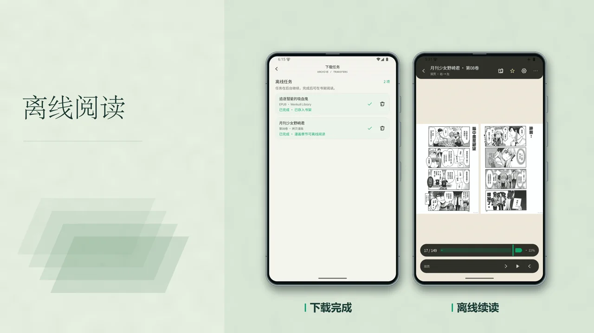 下载中心与离线阅读</td>
<td>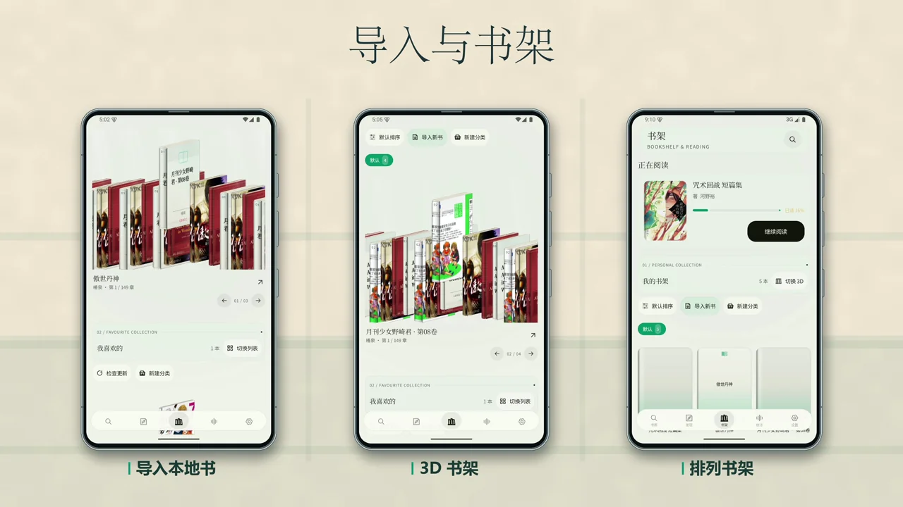 导入本地书与 3D 书架</td>
</tr>
</table>

- **搜索与发现**　聚合搜索小说和漫画，按书源筛选，支持多语言关键词。漫画可从推荐、更新、榜单、统一分类或原站分类进入。
- **收藏与进度**　收藏在线作品、切换可用书源、从最近位置续读。书架支持分类、检索、排序、列表和 3D 展示，以及开合书动效。
- **下载与离线**　按来源下载整本小说或选择漫画章节、卷。下载中心显示进度并提供暂停、恢复和重试。完成后从书架离线打开。

## 小说与电子书

<table>
<tr>
<td width="70%">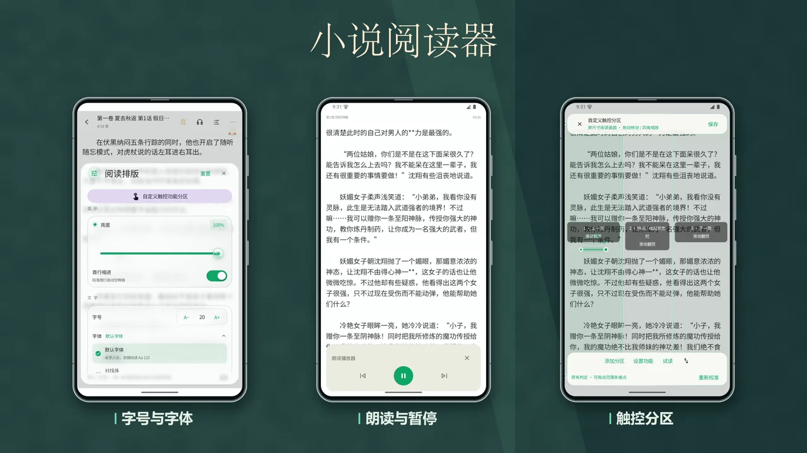 字体、书签与目录 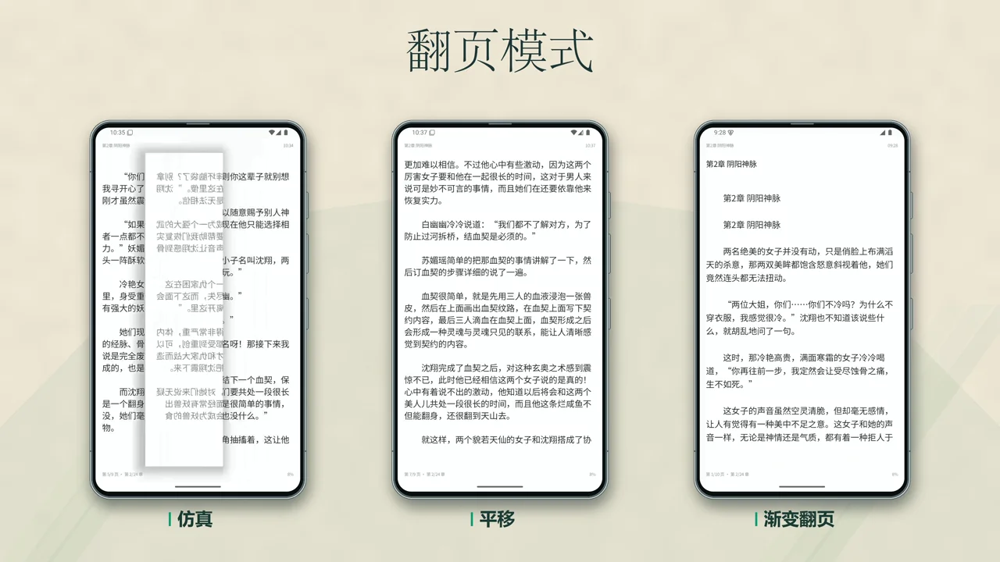 仿真卷页、平移与渐变</td>
<td width="30%" align="center"> EPUB 竖排正文</td>
</tr>
</table>

- **还原书内排版**　标题、粗体、斜体、下划线、删除线和上下标等常见样式按格式保留。EPUB 还会读取书内链接的 CSS，以及封面、目录、插图与书籍排版方向。Markdown 和 HTML 以排版后的正文显示。
- **横排与竖排**　按书设置随原书、横排或竖排。竖排保留左右列方向、插图和阅读进度。
- **自定义阅读**　可调字体、字号、字距、行距、边距、亮度和阅读主题。提供仿真卷页、覆盖、平移、渐变、上下滚动等翻页方式，以及触控分区、休息提醒、目录、书签和正文搜索。

| 可导入格式 | 阅读方式 |
| --- | --- |
| TXT | 自动识别常见编码与章节 |
| EPUB | 图文、目录、常见 CSS 与横竖排 |
| MOBI、AZW、AZW3、PRC | 导入可读的 Kindle/PDB/KF8 正文与支持的样式 |
| DOCX、FB2 | 渲染文字格式并识别章节 |
| Markdown、HTML、XHTML | 将标记渲染为可读正文 |
| CBZ、ZIP | 按顺序阅读压缩包中的漫画图像 |
| PDF | 按原页显示 |

## 听书查词与批注

<table>
<tr>
<td width="25%">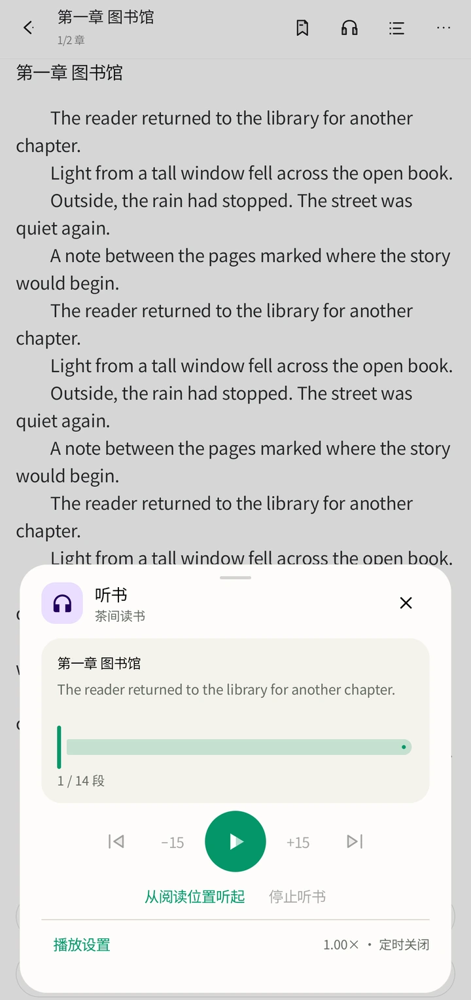 听书播放器</td>
<td width="25%">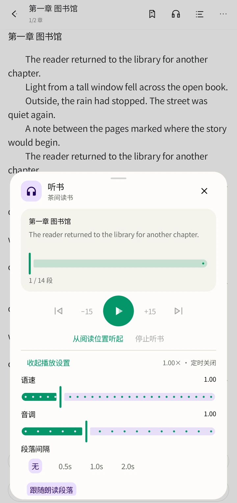 播放设置</td>
<td width="25%">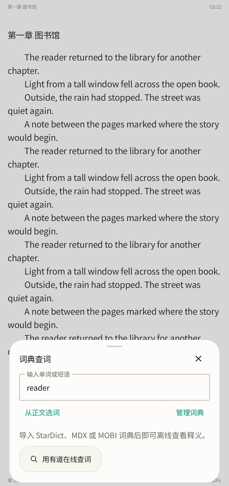 选词直达词典</td>
<td width="25%">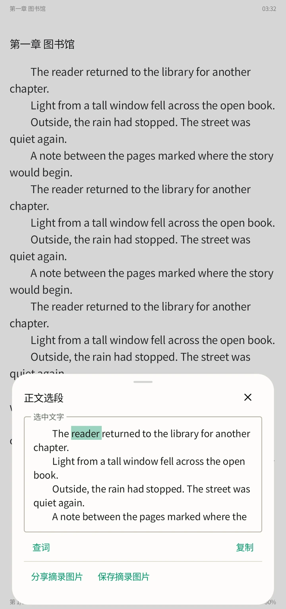 正文选段与阅读时刻</td>
</tr>
</table>

- **听书**　从当前阅读位置或指定段落起播，支持 Android 系统语音、Edge 在线音色和自定义语音接口。可调整语速、音调、段落间隔和睡眠定时，也可查看朗读位置、切换章节。
- **后台播放**　Edge 和自定义语音支持按 15 秒快退或快进。离开阅读页后可继续听，通过通知和锁屏控制播放，听完本章后续播下一章。
- **词典**　长按正文可直接查选中的词，也可在词典面板输入。支持 StarDict、常见 MDX v1/v2 词典、带可读词条的 MOBI/PRC 词典及浏览器在线查询。导入后的词典可离线使用。
- **批注与分享**　选段后可调整范围、复制、加高亮或下划线、写笔记，也可生成带书名与章名的「阅读时刻」PNG，保存或分享。

## 漫画

<table>
<tr>
<td width="50%">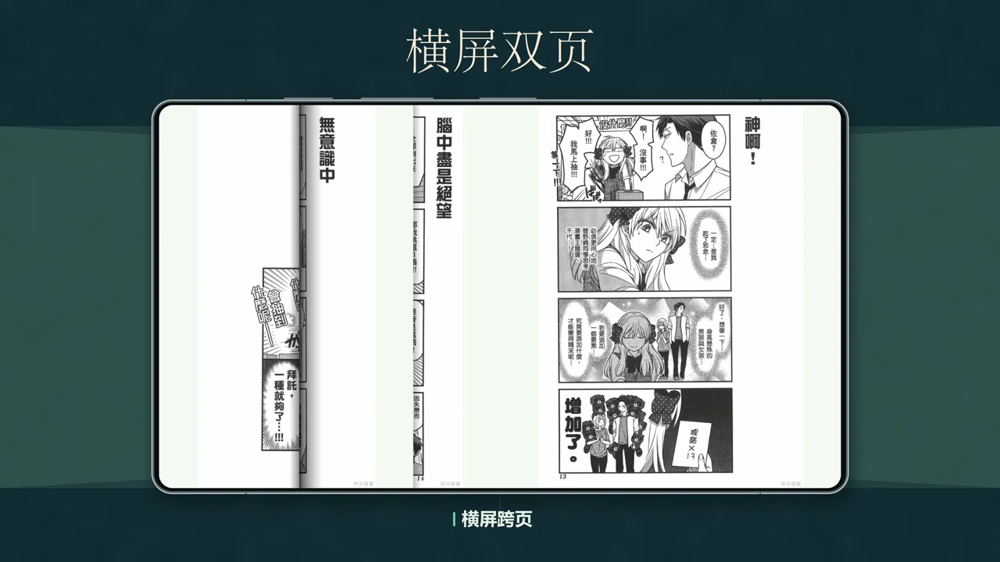 横屏与双页跨页</td>
<td width="50%"> 单页、连续滚动与磁吸停靠</td>
</tr>
<tr>
<td> MangaJaNai 增强前后</td>
<td> 识别并翻译漫画气泡</td>
</tr>
</table>

- 单页、双页、条漫和无缝滚动，支持更改阅读方向、磁吸停靠、双击缩放、裁边、跨页拆分、背景和预加载数量。
- 内置锐化与线条增强。JaNai 极速可直接使用，MangaJaNai 完整版下载模型后可离线增强。
- 在设备上检测气泡并识别文本，使用选定的在线翻译服务或自定义 AI 接口生成译文。支持按页翻译与原图切换。
- 可配置漫画阅读预设、触控分区和环境声。

## 统计与个性化

<table>
<tr>
<td width="50%">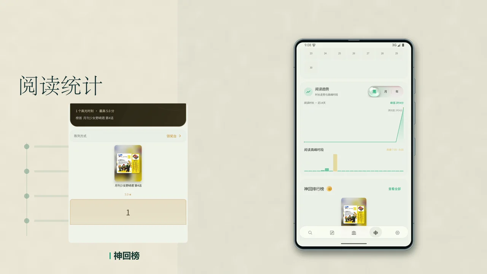 阅读日历、趋势与神回榜</td>
<td width="50%">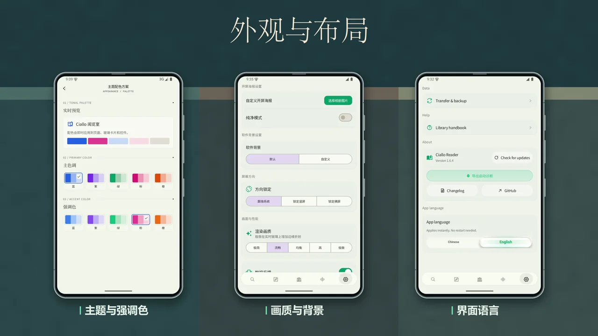 主题、强调色与显示布局</td>
</tr>
</table>

- 查看阅读时长、阅读历史、日历和趋势，记录喜欢的章节并在神回榜查看。
- 自定义强调色、浅色或深色主题、界面背景、画质、触感、中英文界面和方向锁定。
- 支持手机、平板与横屏布局。可开启极简画质或减少动态效果。
- 隐私模式可为指定书架分类和「我喜欢的」加 PIN 保护。可从设置管理缓存、自动备份和检查更新。

## 书源与备份

<table>
<tr>
<td width="50%">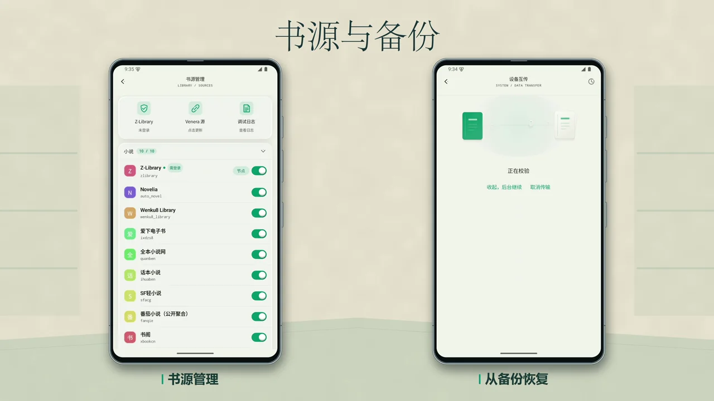 书源管理与备份恢复</td>
<td width="50%">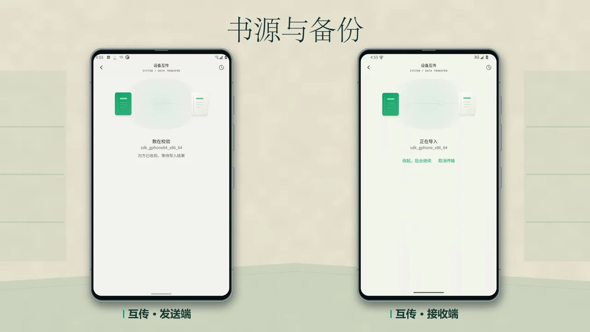 设备互传的发送端和接收端</td>
</tr>
</table>

- **书源管理**　启用或停用小说与漫画源，导入自定义 Legado JSON 规则，支持 CSS 与 JSON 选择规则。在线内容取决于来源，有些站点需要登录或验证。
- **便携备份**　按类别选择书籍、进度、收藏、标注、历史、设置和书源等，导出为 `.ciallo` 文件。导入时可查看预览，选择合并或整机迁移，支持最近一次迁移撤销。
- **设备互传**　支持同 Wi-Fi、热点与附近 Wi-Fi Direct，核对校验码后开始加密传输。可查看进度、取消或续传。详见 [设备互传与备份](docs/device-transfer.md)。

## 安装与上手

1. 在 [GitHub Releases](https://github.com/roxycon-dev/Ciallo-Reader/releases/latest) 下载 ARM64 APK，按系统提示安装。同一版本提供 `SHA256SUMS.txt` 校验文件。
2. 打开「书架 → 导入新书」选择本地文件，或从「书库」选择小说、漫画或聚合搜索。可到「设置 → 书源管理」启用需要的来源。
3. 在小说阅读页点按正文呼出工具栏。点耳机开始听书，长按正文可选段、查词、批注和导出阅读时刻。

## 开发、反馈与许可

使用 Kotlin、Jetpack Compose、Material 3、Room 和 WorkManager。需要 JDK 17+、Android SDK 35、Build Tools 36.1.0、NDK 29.0.14206865 和 CMake 3.22.1。运行 `./gradlew :app:assembleDebug` 构建调试版。Windows 使用 `gradlew.bat :app:assembleDebug`。正式构建见 [发布签名](docs/app-signing.md)。

欢迎报告问题和补充复现步骤。感谢所有参与反馈的读者、贡献者，以及分享阅读界面与交互参考的 Wenku8 Flutter 作者和贡献者。[GitHub Issues](https://github.com/roxycon-dev/Ciallo-Reader/issues) · [贡献者](https://github.com/roxycon-dev/Ciallo-Reader/graphs/contributors) · [Wenku8 Flutter](https://github.com/mikufoxxx/Wenku8_Flutter)

原创源代码采用 MIT。第三方内容和组件依各自许可使用。漫画翻译示意图取自 David Revoy 的《Pepper&Carrot》第 1 话第 2 页，画面经过裁切和放大。[MIT 许可](LICENSE) · [第三方许可](docs/vendor-licenses/README.md) · [漫画原作](https://www.peppercarrot.com/en/webcomic/ep01_Potion-of-Flight.html) · [CC BY 4.0](https://creativecommons.org/licenses/by/4.0/)
