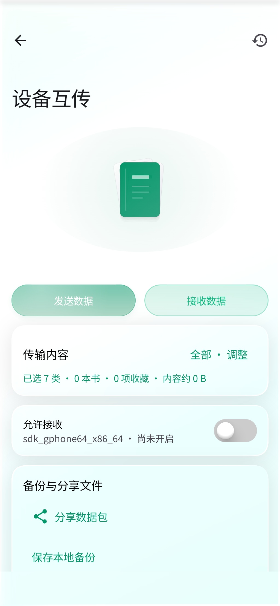
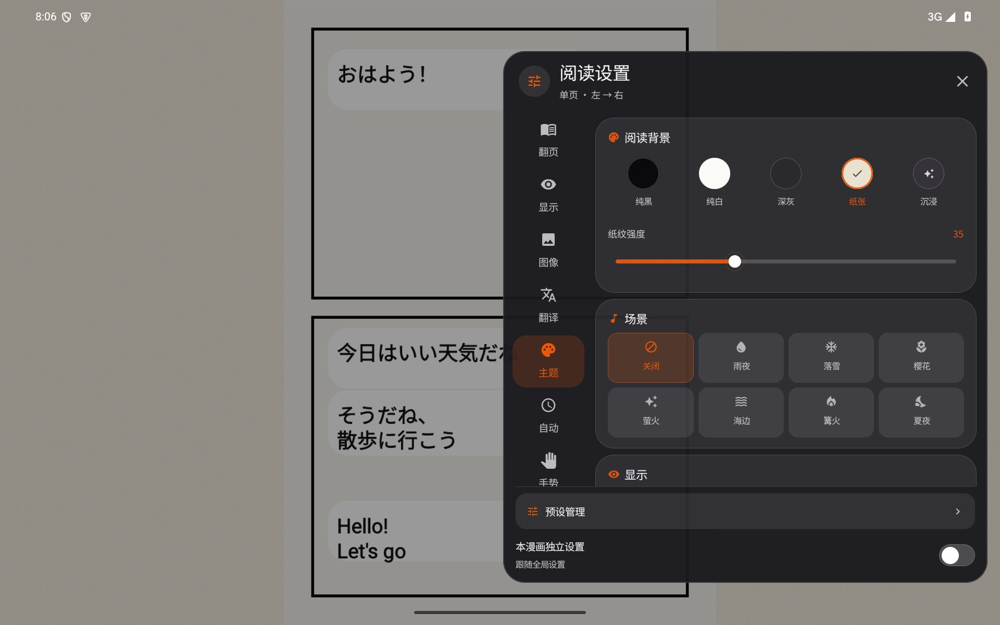
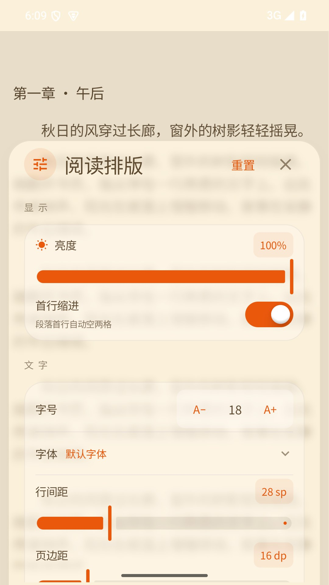
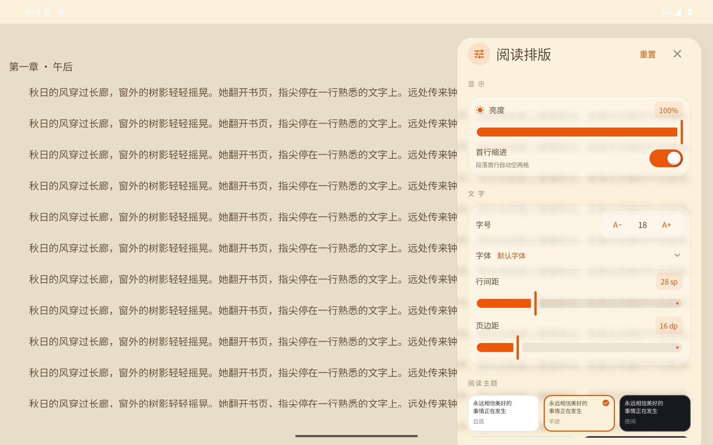
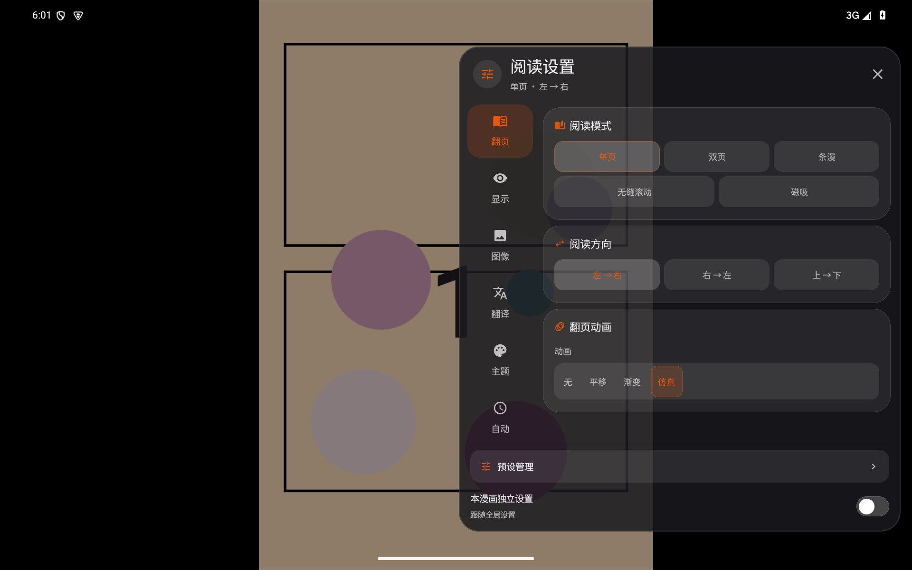
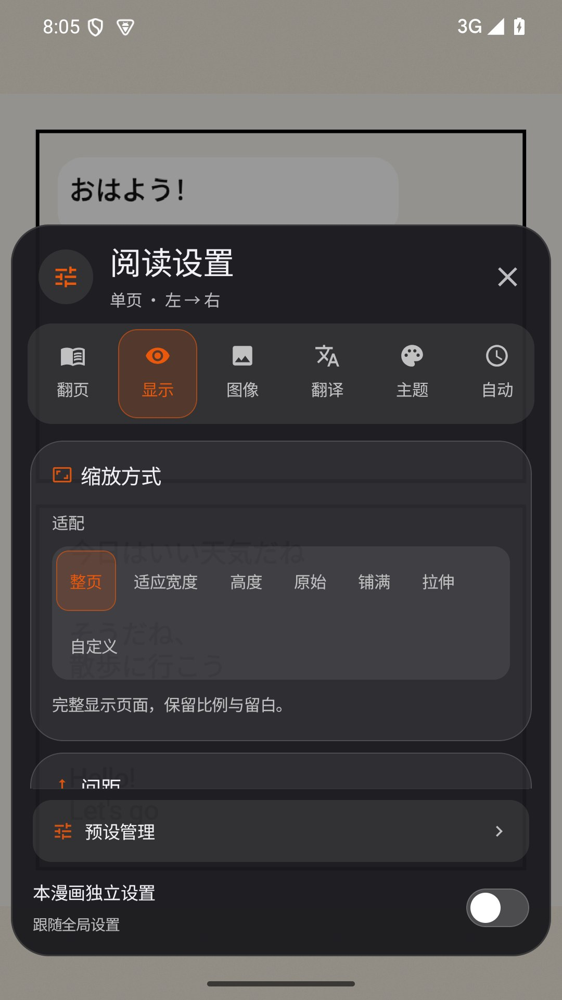

[简体中文](README.md) · [English](README_EN.md)

# Ciallo Reader — Android Novel, Manga & Ebook Reader

**Find books online. Keep your library organized. Read offline.**  
Read local ebooks, novels, and comics in one Android app.

[🌐 Product site](https://roxycon-dev.github.io/Ciallo-Reader/) ·
[⬇️ Download the latest APK](https://github.com/roxycon-dev/Ciallo-Reader/releases/latest) ·
[1.4.15 release notes](docs/release-1.4.15-2026-10-21.md) ·
[See screenshots](#screenshots) ·
[Features](#features) ·
[Report an issue](https://github.com/roxycon-dev/Ciallo-Reader/issues)

Ciallo Reader is an **Android ebook reader, novel reader, and manga/comic reader** for local files and configurable online sources. Search books across sources, import your own files, download novels or comic chapters, and continue reading from your library offline.

**1.4.15 / 238** adds a lightweight live-content paper warp: one GPU sample retains the neck, progressive release, bend, flutter and return without snapshots or hidden source cards. Tab height and label space now share one progress value, eliminating the final-frame icon jump. Partial-window corner glints are removed, and the source picker waits for the shared close lifecycle. See [release notes](docs/release-1.4.15-2026-10-21.md).

**1.4.14 / 237** replaces the complex paper mesh with one lightweight spring transition to address disappearing cards and displaced text reported during rapid scrolling and repeated taps in 1.4.13. It removes the extra offscreen renderer, GPU readbacks, trigger hiding and capture waits. Existing glass styling, themes, dismissal ordering, sliders and reading gestures remain. Glass press tracking stops as soon as scrolling takes over. See [release notes](docs/release-1.4.14-2026-10-21.md).

**1.4.13 / 236** fixes slider jumps caused by vertical scrolling, touching a settling lens and additional fingers. Paper transitions retain the full mesh, glass refraction and shadows, with isolated backdrop sampling, on-demand source capture and less repeated curve work. It removes the session-wide slow-frame downgrade, completes discovery trigger registration, sequences follow-up actions after dismissal and removes duplicate headers in the manual and cache manager. See [release notes and verification](docs/release-1.4.13-2026-10-21.md).

**1.4.12 / 235** fixes paper transition stalls and modal open/close ordering with hardware mesh rendering, on-demand snapshots and one physical lifecycle. Native free corner curls and slow partial-page returns are restored; calibrated distance applies only to fast complete flips, with opposite previous/next guides and diagonal calibration. In-place touch editing, shared liquid sliders and the source fixes from 1.4.11 remain included. See [release notes and verification](docs/release-1.4.12-2026-10-21.md).

**1.4.10 / 233** adds **书阁 (Shuge, `xbookcn`)**, an account-free Chinese novel source with search, details, a full table of contents, online text and whole-book EPUB download. The site ships no whole-book file, so the app fetches chapters and packages the EPUB locally, comparing the table of contents before and after and discarding the whole book if any chapter differs. It also fixes normal pages being misread as verification pages because of injected Cloudflare scripts, and retries once when the site drops a TLS handshake. Other sources and existing download paths are unchanged. See the [release notes and download](docs/release-1.4.10-2026-10-19.md).

**1.4.9 / 232** repairs EPUB illustrations from Wenku8 and Z-Library, including already imported books, and prevents isolated missing characters in valid Novelia translations from blocking a whole novel. Z-Library excludes hidden query-reflecting decoy cards and recovers failed downloads across available nodes. A visible download entry shows progress, file details and retry controls. See the [release notes and download](docs/release-1.4.9-2026-10-19.md).

**1.4.8 / 231** adds three sources that require no account: **全本小说网 (Quanben)**, **话本小说 (Huaben)** and **SF轻小说 (SFACG)**. Download complete EPUBs with inline illustrations for offline reading. Existing source labels become **Novelia** and **Wenku8 Library**. Integrity checks reject detected chapter gaps, invalid text, missing images and known placeholder content before import. This release also includes favorite cover and fractional manga episode label fixes. See the [release notes and download](docs/release-1.4.8-2026-10-19.md).

The three new sources were checked through search, whole-book download, import and the production reader using public sample books. They provide offline EPUB reading; locked chapters prevent whole-book export. Generated EPUB downloads restart after a pause. All 31 executed Android tests and 22 JVM regression tests passed; two experimental source tests remain explicitly ignored. These samples do not establish coverage of every title, source-text completeness or updates matching every original platform. See the [verification report](docs/novel-guest-sources-verification-2026-10-19.md).

1.4.7 added anonymous Xipi and 19 Manga sources with native categories, status filters, sorting and pagination, plus the transfer merge fixes. Previous chapter checks are recorded in the [1.4.7 release notes](docs/release-1.4.7-2026-10-18.md).

Enable **嬉皮漫画 (Xipi)** for Money-First Hero and choose the original chapter title **鹰身女妖&天使** for episode 180.5. Use **19漫画 (19 Manga)** for the other three titles. Native category labels and routes are read from the sites, then mapped to the app's shared taxonomy. Verification reflects availability on 2026-10-18; see the [source audit](docs/latest-comic-source-verification-2026-10-18.md) for episode identity, page counts and scope.

Also repairs legacy Android API compatibility, glass effect cleanup, EPUB path handling and Compose state subscriptions found during release checks.

## Screenshots

### Device transfer and backups

This is an Android emulator screenshot with a test background. Wireless transfers between physical devices still need validation.

### Reading settings and layouts

The screenshots below are from Android emulator builds. Reading text and comic pages are generated sample content. See the [v1.2.5 refinement notes and four screen-size examples](docs/comic-feature-polish-1.2.5-2026-10-07.md).

<table>
<tr>
<td align="center"></td>
</tr>
<tr>
<td align="center"><strong>Novel settings · phone</strong> </td>
<td align="center"><strong>Novel settings · tablet</strong> </td>
</tr>
<tr>
<td align="center"><strong>Manga settings · tablet</strong> </td>
<td align="center"><strong>Manga settings · phone</strong> </td>
</tr>
</table>

### More app screens

These 12 earlier screenshots show source management, library search, the bookshelf, reading, comic details, reading statistics, and settings.

<table>
<tr><td align="center"><strong>Source management</strong> </td><td align="center"><strong>Library search</strong> </td><td align="center"><strong>Themes and orientation</strong> </td></tr>
<tr><td align="center"><strong>Reading calendar and trends</strong> </td><td align="center"><strong>Reading insights and rankings</strong> </td><td align="center"><strong>Bookshelf and continue reading</strong> </td></tr>
<tr><td align="center"><strong>Manga page turn</strong> </td><td align="center"><strong>Novel page turn</strong> </td><td align="center"><strong>Manga details and tags</strong> </td></tr>
<tr><td align="center"><strong>Chapters, highlights, and bookmarks</strong> </td><td align="center"><strong>Highlight ranking</strong> </td><td align="center"><strong>Reader settings</strong> </td></tr>
</table>

> Some older screenshots may differ from the current interface. Reading text and comic pages are sample content.

## Features

### Device transfer and portable backups

- Open Settings → Device transfer and backups to send or receive selected categories: books, favorites, annotations, history, settings, resources, and sources.
- Implements same-network/hotspot discovery and nearby Wi-Fi Direct, encrypted transfer after code confirmation, progress, cancellation, and resume.
- Merge keeps local settings and the latest reading position. Full migration requires separate confirmation and keeps one undo snapshot.
- Share a `.ciallo` file through Android and open it on the receiving device to inspect and import. Legacy ZIP backups remain readable. Protected content is excluded by default; PINs, login sessions, and keys are not transferred.
- Both devices need a compatible Android version. Cross-brand devices, environments without Google services, wireless links, and WeChat/QQ file reception still need physical-device validation. See [usage and validation scope](docs/device-transfer.md).

### Discover comics

Version 1.3.8 adds Discover and restores Aiman and MYCOMIC reading. Its APK retains the 1.3.6 signing identity; the differently signed 1.3.7 requires a data backup before migrating.

- Browse one source or merge sources with separate update, discussion, ranking, and view dimensions. Missing statistics are shown explicitly.
- Standard categories coexist with native source categories, with saved filters, three layouts, pagination, Library favorites, ring pull-to-refresh, and bottom-tab double-tap refresh.
- Version 1.3.8 repairs discovery feeds, metadata, and pagination, and restores Aiman's public reading path through the HTTPS origin declared by its publisher.
- MYCOMIC reads public pages with the same in-app WebView engine and session used for site verification. Its real Android verification → catalogue → detail → chapter → reader image decoding chain passed: 30 catalogue entries, 16 chapters, 61 pages, and decoded first/last images. See [validation details](docs/release-1.3.8-2026-10-14.md).

### One library for novels, ebooks, and comics

- Import and read TXT, EPUB, MOBI, AZW, AZW3, PRC, DOCX, FB2, CBZ, ZIP, and PDF files.
- Search enabled online sources in parallel; supported novel results can be opened in the app.
- Download full novels or comic chapters for offline reading, with resumable downloads.
- Import Legado JSON sources and custom CSS/JSON rules.
- Keep reading progress, chapter bookmarks, favorites, and reading statistics in your library. Supported reading records can be migrated when changing sources.

### Personalize the reading experience

- Novel reader with page curl, cover, slide, fade, and scroll modes; adjustable fonts, text size, line spacing, margins, themes, and text-to-speech.
- Manga reader with single-page, two-page, webtoon, and continuous-scroll modes, plus reading-direction controls, zoom, crop, and page splitting.
- Presets for different reading styles, night themes, and a Minimal graphics option for lower-performance devices.
- Layouts adapt to phones, tablets, and landscape screens.

### Manga image enhancement and translation

- Image sharpening, line enhancement, JaNai Quick processing, and the optional MangaJaNai Full model.
- MangaJaNai Full can run offline after its model is downloaded. The first download is about 76 MB; lightweight processing options remain available.
- OCR and speech-bubble detection run on device. Translated text is generated by the selected online translation service or custom AI API.

## Supported formats

| Format | Reading support |
| --- | --- |
| TXT | Chunked loading, chapter detection, and multiple encodings |
| EPUB | Table of contents, cover, metadata, and embedded images |
| MOBI, AZW, AZW3, PRC | Kindle/PDB/KF8 file parsing |
| DOCX, FB2 | Text extraction and chapter splitting |
| CBZ, ZIP | Comic image ordering and reading |
| PDF | Page-by-page viewing; PDF text-layer extraction is not supported yet |

## Install

- **Android:** 7.0 (API 24) or newer.
- **Architecture:** Current release APKs target arm64-v8a, supported by most Android phones and tablets. The release APK does not include an x86_64 emulator build.
- **Download:** Visit [Latest Releases](https://github.com/roxycon-dev/Ciallo-Reader/releases/latest). You can also [download v1.4.12 directly](https://github.com/roxycon-dev/Ciallo-Reader/releases/download/v1.4.12/Ciallo-Reader-v1.4.12.apk).
- Open the downloaded APK and follow Android's prompt to allow installation from that source.

## Get started

**Import a local ebook or comic:** Open the bookshelf, choose Import Book, and select a supported file.

**Search online sources:** Open Library and choose novels, comics, or aggregate search. Enable, manage, or import sources under Settings → Source Management. Online sources are provided by third parties, so search results and availability may change.

**Read offline:** Download a full novel or comic chapters from a supported source, then open the downloaded item from your bookshelf. Online search, streaming, and translation require a network connection.

## FAQ

**Why is search returning no results?**  
Check your connection and source settings, try aggregate search, or change the query. Some sources require sign-in, verification, or a specific network environment. Changes on a source website may temporarily affect results.

**Can I read downloaded books offline?**  
Yes. Open completed downloads from your local bookshelf. Online search, online reading, and network translation still require their respective services.

**What is sent online during manga translation?**  
OCR and speech-bubble detection run on device. To generate translations, recognized text is sent to the online translation service or custom API you selected. Review that service's privacy terms.

**Why does MangaJaNai Full download a model?**  
The full enhancement model is large, so it is downloaded on demand. After the download completes, it can be used offline. Other image-processing options do not require this model.

## Build and feedback

The project uses **Kotlin, Jetpack Compose, Material 3, Room, and WorkManager**. Local builds require JDK 17, Android SDK 35, NDK 29.0.14206865, and CMake 3.22.1:

~~~bash
git clone https://github.com/roxycon-dev/Ciallo-Reader.git
cd Ciallo-Reader
./gradlew :app:assembleDebug
~~~

On Windows, use gradlew.bat :app:assembleDebug. For bugs and feature requests, open a [GitHub Issue](https://github.com/roxycon-dev/Ciallo-Reader/issues) with the app version, device model, and reproduction steps.

- [Changelog](CHANGELOG.md)
- [v1.3.6 release notes and verification](docs/release-1.3.6-2026-10-12.md)
- [Third-party component and model licenses](docs/vendor-licenses/README.md)

## Content sources and license

Ciallo Reader is a reading and library-management app. Online sources and translation services are provided by third parties; their content, availability, and terms are controlled by those providers. Please follow local laws, source-site rules, and copyright requirements.

Original source code written for this project is released under the [MIT License](LICENSE). Third-party source code, model weights, datasets, fonts, images, audio, and other materials with separate license or attribution terms are excluded and remain under their respective terms. See the [third-party license and source records](docs/vendor-licenses/README.md). In particular, the MangaJaNai models are CC BY-NC 4.0 and the multilingual search keyword database is CC BY-NC-SA 3.0 China Mainland; the MIT license does not remove those restrictions.

