

# Ciallo Reader

An Android reader for novels, manga, and ebooks. Find titles online, organize your collection, and pick up where you left off offline.

**[Download APK](https://github.com/roxycon-dev/Ciallo-Reader/releases/latest)** · [Product site](https://roxycon-dev.github.io/Ciallo-Reader/) · [简体中文](README.md)

Android 7.0+ · ARM64 · [Changelog](CHANGELOG.md)

[1.6.5 release notes](https://github.com/roxycon-dev/Ciallo-Reader/releases/tag/v1.6.5)

[Discovery and shelf](#discovery-and-shelf) · [Novels and ebooks](#novels-and-ebooks) · [Listening and annotations](#listening-dictionaries-and-annotations) · [Manga](#manga) · [Stats and appearance](#stats-and-appearance) · [Sources and backups](#sources-and-backups) · [Getting started](#getting-started)

## Discovery and shelf

<table>
<tr>
<td width="50%">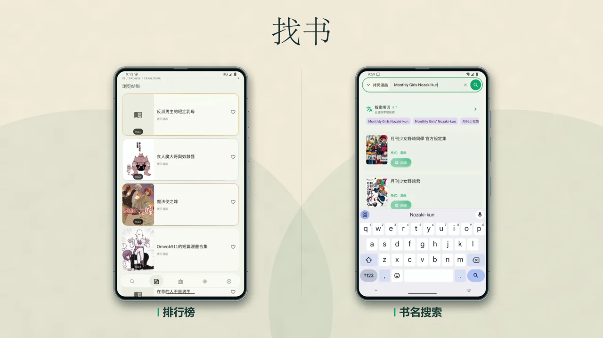 Rankings and cross-source search</td>
<td width="50%"> Title details and resume reading</td>
</tr>
<tr>
<td>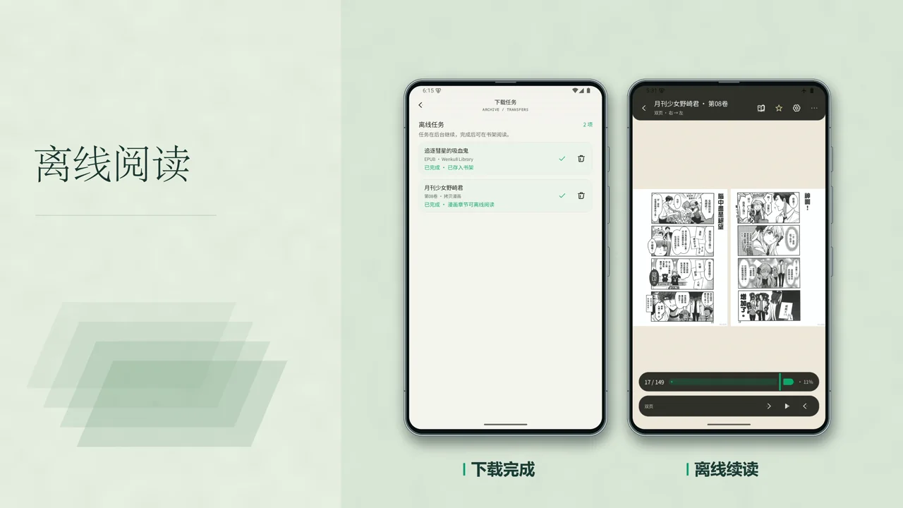 Download center and offline reading</td>
<td>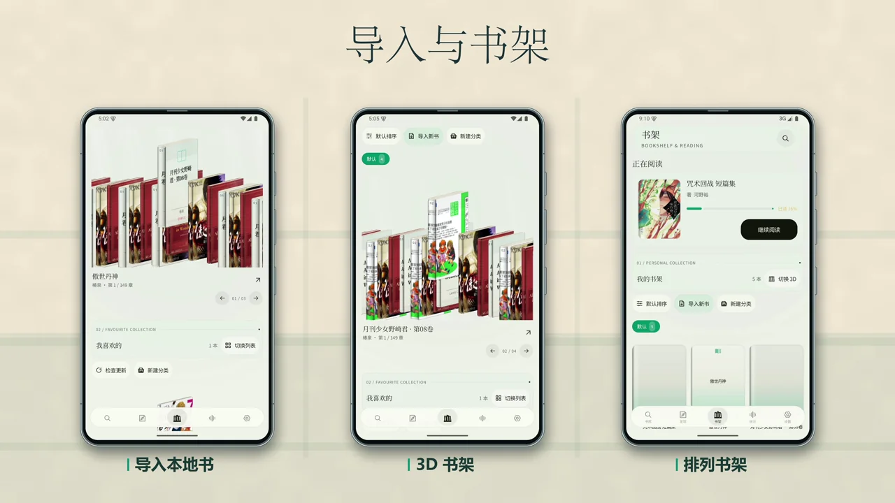 Local import and 3D bookshelf</td>
</tr>
</table>

- Search novels and manga across sources, filter by provider, and use multilingual keywords. Browse recommendations, updates, rankings, shared categories, and source categories.
- Favorite online titles and resume from your saved position. Organize the shelf with categories, search, sorting, a list, and a 3D view with book-opening transitions.
- Download whole novels or selected manga chapters and volumes where the source supports it. Pause, resume, or retry downloads in the download center. Finished titles open offline from the shelf.

## Novels and ebooks

<table>
<tr>
<td width="70%">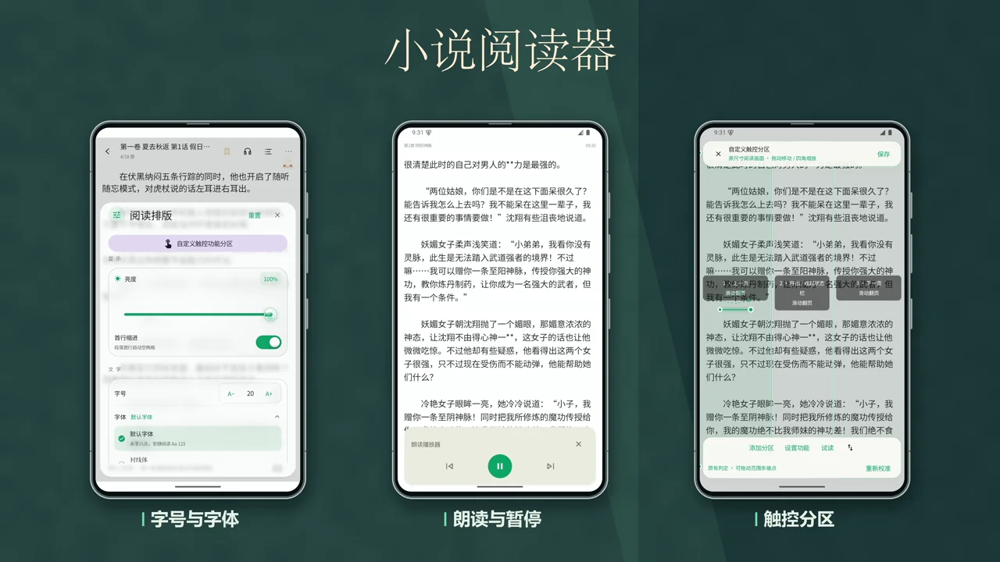 Fonts, bookmarks, and chapter list 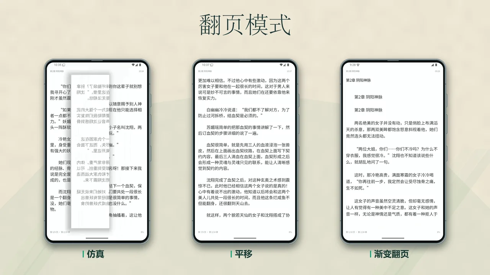 Page curl, slide, and fade</td>
<td width="30%" align="center"> Vertical EPUB text</td>
</tr>
</table>

- Keep supported headings, bold, italic, underline, strikethrough, superscript, and subscript. EPUB also reads linked in-book CSS, cover art, chapter lists, illustrations, and writing direction. Markdown and HTML open as rendered text.
- Follow the book’s writing mode or select horizontal or vertical text per book. Vertical reading supports both column directions, illustrations, and saved progress.
- Set typeface, font size, character and line spacing, margins, brightness, and reader theme. Choose page curl, cover, slide, fade, or scroll. Use adjustable touch zones, break reminders, bookmarks, chapter navigation, and text search.

| Formats | Reading support |
| --- | --- |
| TXT | Common encodings and chapter recognition |
| EPUB | Text and images, contents, common CSS, and horizontal or vertical text |
| MOBI, AZW, AZW3, PRC | Readable Kindle, PDB, and KF8 files with supported styling |
| DOCX, FB2 | Formatted text and chapter recognition |
| Markdown, HTML, XHTML | Rendered text |
| CBZ, ZIP | Ordered comic images |
| PDF | Original page display |

## Listening, dictionaries, and annotations

<table>
<tr>
<td width="25%">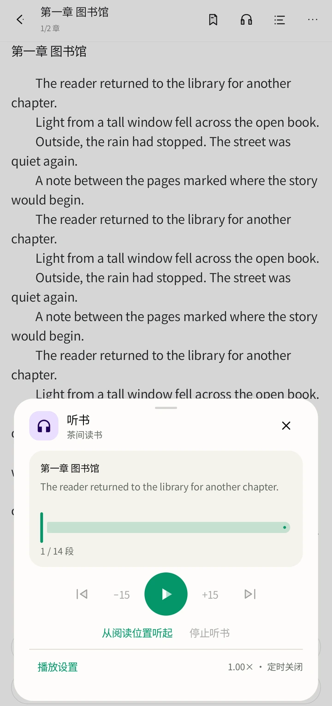 Listening player</td>
<td width="25%">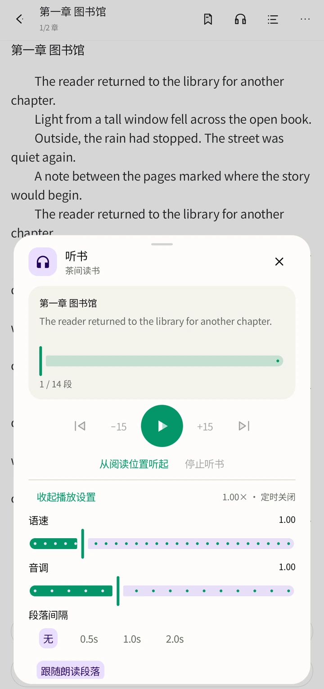 Playback settings</td>
<td width="25%">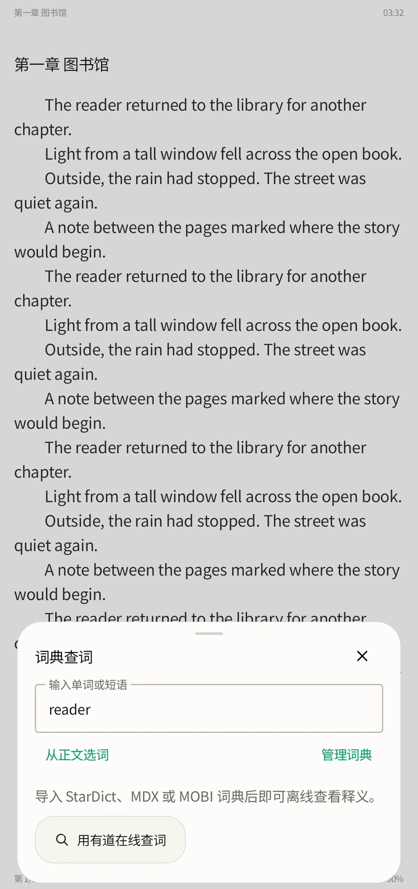 Look up selected text</td>
<td width="25%">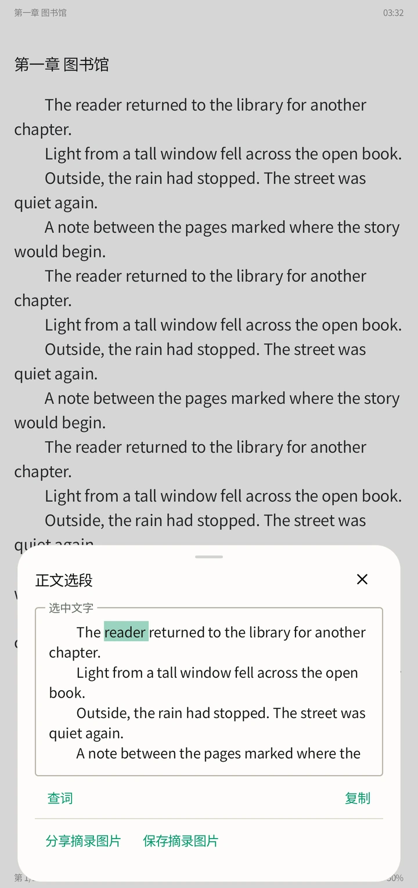 Selection and Reading Moment</td>
</tr>
</table>

- Start listening at your reading position or a selected paragraph with Android system voices, online Edge voices, or a custom speech endpoint. Adjust speed, pitch, pauses, and the sleep timer.
- Skip 15 seconds backward or forward with Edge and custom voices. Keep listening in the background, use media controls on the lock screen or in notifications, and continue into the next chapter.
- Long-press text to look up the selection, or enter a word in the dictionary panel. Import StarDict, common MDX v1/v2 files, and MOBI/PRC dictionaries with readable entries for offline use. A browser lookup is also available.
- Select a passage to copy, highlight, underline, or annotate it. Save or share a Reading Moment PNG with the selected text, title, and chapter.

## Manga

<table>
<tr>
<td width="50%">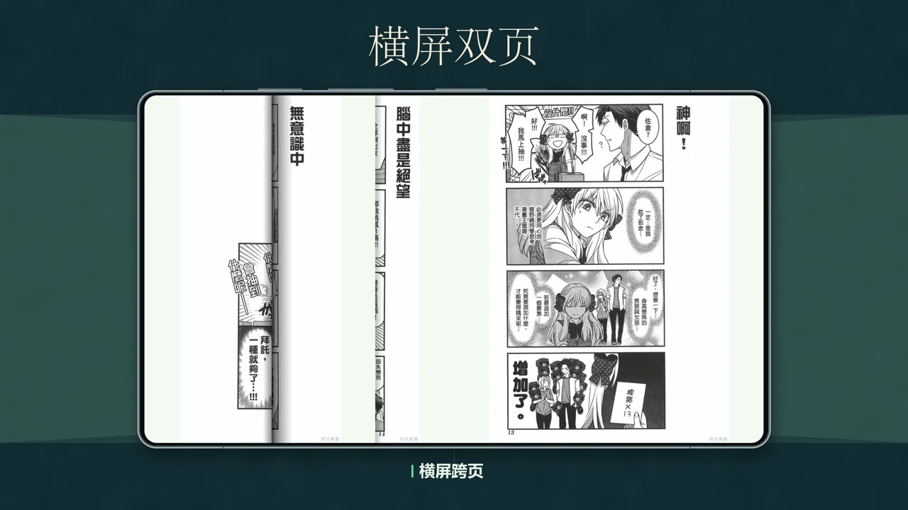 Landscape and two-page spreads</td>
<td width="50%"> Single page, continuous scrolling, and snapping</td>
</tr>
<tr>
<td> Before and after MangaJaNai</td>
<td> Translated speech bubbles</td>
</tr>
</table>

- Read in single-page, two-page, webtoon, or seamless scrolling mode. Set reading direction, page snapping, double-tap zoom, trimming, spread splitting, background, and preloading.
- Use built-in sharpening, line enhancement, or JaNai fast processing. The full MangaJaNai model runs offline after download.
- Detect speech bubbles and recognize text on device. Translate pages using the selected online service or custom AI endpoint, and switch back to the original image.
- Configure manga reading presets, touch zones, and ambient sound.

## Stats and appearance

<table>
<tr>
<td width="50%">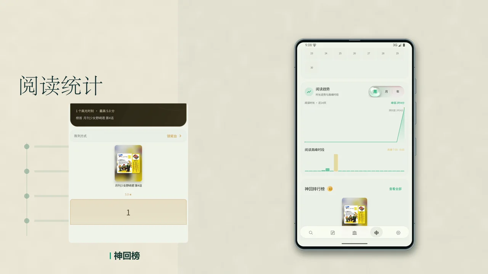 Reading calendar, trends, and chapter rankings</td>
<td width="50%">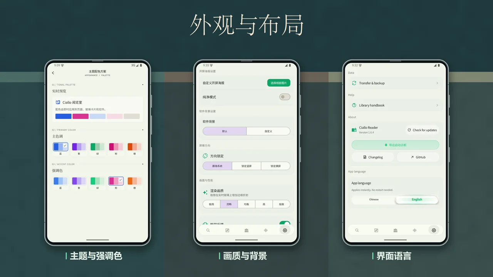 Themes, accent colors, and layout</td>
</tr>
</table>

- View reading time, history, calendar, and trends. Rate favorite chapters and see them in the chapter rankings.
- Customize accent colors, light or dark themes, backgrounds, graphics quality, haptics, and orientation lock. Switch between Chinese and English.
- Use phone, tablet, and landscape layouts with minimal graphics and reduced-motion options.
- Use a PIN to protect selected shelf categories and favorites. Settings also provides cache management, automatic backups, and update checks.

## Sources and backups

<table>
<tr>
<td width="50%">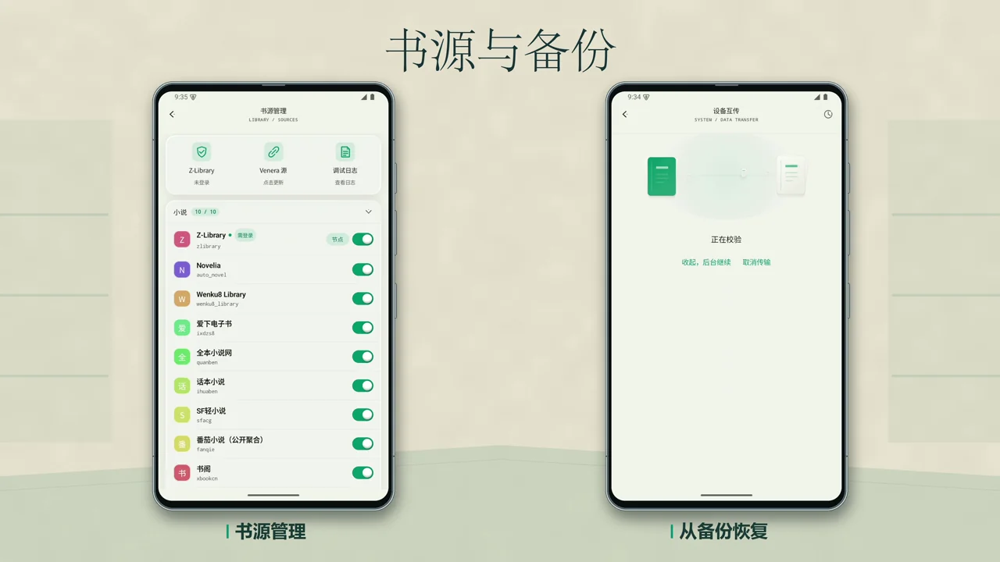 Source management and backup restore</td>
<td width="50%">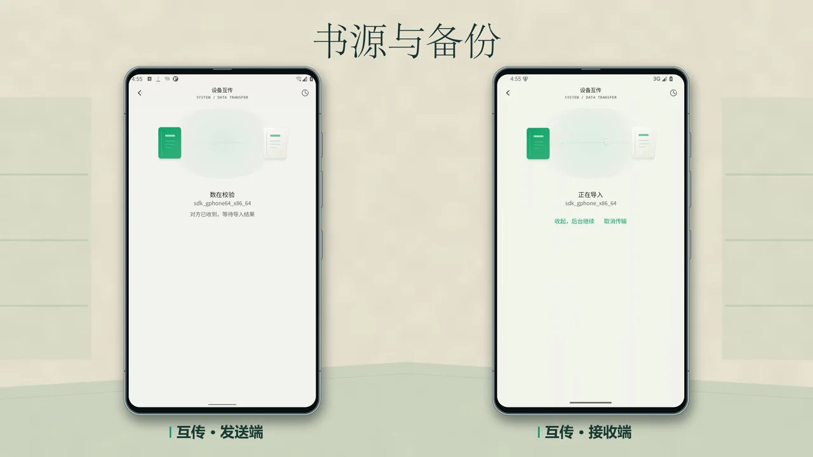 Sending and receiving books</td>
</tr>
</table>

- Manage built-in novel and manga sources or import custom Legado JSON sources with CSS and JSON selection rules. Availability, sign-in, and verification depend on the provider.
- Export books, progress, favorites, annotations, history, settings, and sources as a portable `.ciallo` backup. Preview imports, merge or migrate the whole device, and undo the last migration.
- Transfer files over the same Wi-Fi network, a hotspot, or Wi-Fi Direct. Confirm the pairing code for encrypted transfers with progress, cancellation, and resume. [Device transfer and backup guide](docs/device-transfer.md)

## Getting started

1. Download the ARM64 APK from [GitHub Releases](https://github.com/roxycon-dev/Ciallo-Reader/releases/latest) and follow Android’s install prompt. Each release includes `SHA256SUMS.txt`.
2. Open **Shelf → Import books** for local files, or search for titles in **Library**. Enable your preferred providers in **Settings → Source management**.
3. Tap the novel reader to show its controls. Select the headphones to start listening. Long-press text to look up a word, mark a passage, or export a Reading Moment.

## Development, feedback, and licenses

Built with Kotlin, Jetpack Compose, Material 3, Room, and WorkManager. Use JDK 17+, Android SDK 35, Build Tools 36.1.0, NDK 29.0.14206865, and CMake 3.22.1. Run `./gradlew :app:assembleDebug` or `gradlew.bat :app:assembleDebug` on Windows. [Release signing](docs/app-signing.md)

Thanks to the readers and contributors who reported issues, and to the Wenku8 Flutter contributors for sharing reader UI and interaction references. [GitHub Issues](https://github.com/roxycon-dev/Ciallo-Reader/issues) · [Contributors](https://github.com/roxycon-dev/Ciallo-Reader/graphs/contributors) · [Wenku8 Flutter](https://github.com/mikufoxxx/Wenku8_Flutter)

Original project code is MIT licensed. Third-party components and content follow their respective terms. The translation demo uses a cropped and enlarged portion of page 2 from episode 1 of David Revoy’s *Pepper&Carrot*. [MIT license](LICENSE) · [Third-party licenses](docs/vendor-licenses/README.md) · [Original comic](https://www.peppercarrot.com/en/webcomic/ep01_Potion-of-Flight.html) · [CC BY 4.0](https://creativecommons.org/licenses/by/4.0/)
