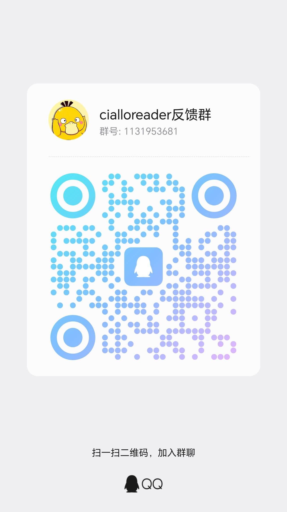
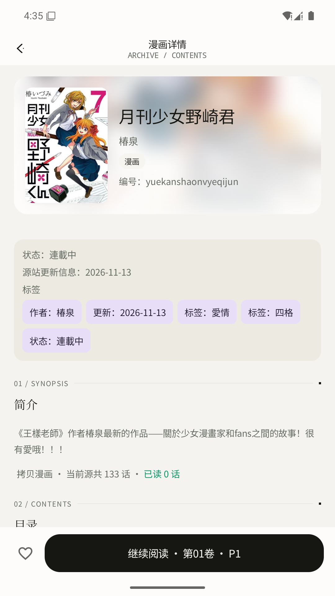
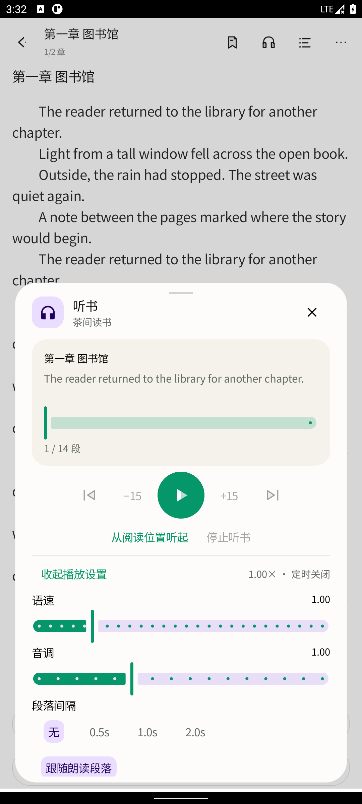
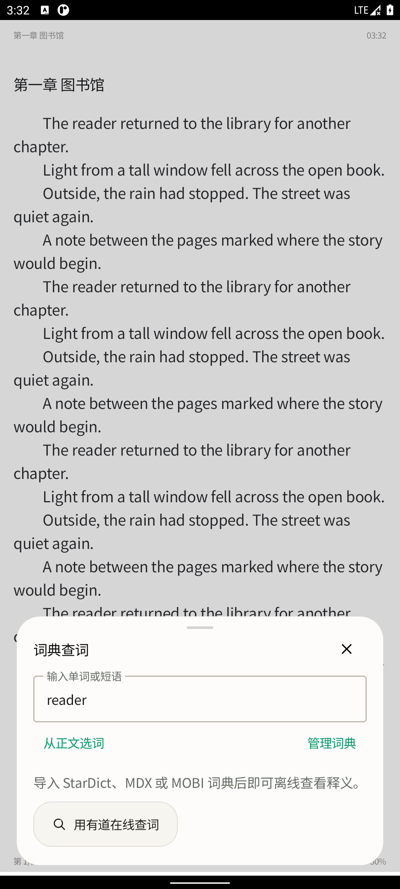
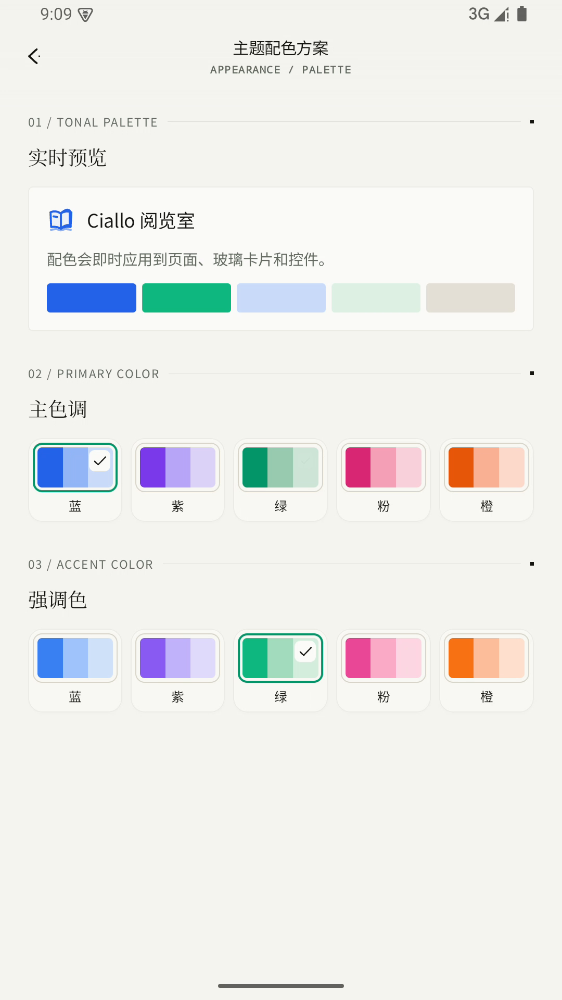
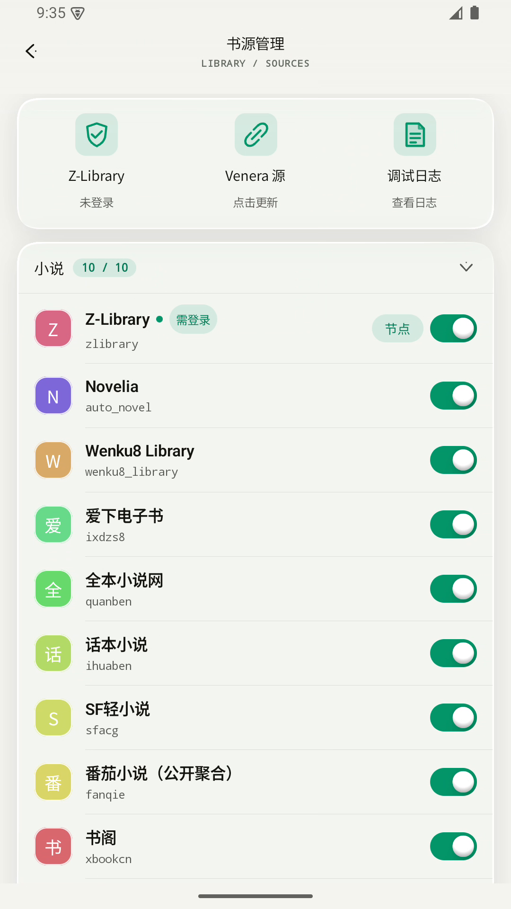

# Ciallo Reader

An Android reader for novels, manga, and ebooks. Find titles online, organize your collection, and pick up where you left off offline.

**[Download APK](https://github.com/roxycon-dev/Ciallo-Reader/releases/latest)** · [Product site](https://roxycon-dev.github.io/Ciallo-Reader/) · [简体中文](README.md)

Android 7.0+ · ARM64 · [Changelog](CHANGELOG.md)

## QQ feedback group

**Group number `1131953681`** · Join to report bugs and suggest features. Search for the group number in QQ or open the QR code below to scan it.

[1.6.10 release notes](https://github.com/roxycon-dev/Ciallo-Reader/releases/tag/v1.6.10)

[Discovery and shelf](#discovery-and-shelf) · [Novels and ebooks](#novels-and-ebooks) · [Listening and annotations](#listening-dictionaries-and-annotations) · [Manga](#manga) · [Stats and appearance](#stats-and-appearance) · [Built-in sources](#built-in-sources) · [Backups and transfers](#backups-and-device-transfer) · [Getting started](#getting-started)

## Discovery and shelf

<table>
<tr>
<td width="33%" align="center"> Manga recommendations in Discovery</td>
<td width="33%" align="center"> Search results from multiple sources</td>
<td width="33%" align="center"> Title details and resume reading</td>
</tr>
<tr>
<td width="33%" align="center"> Completed tasks in the download center</td>
<td width="33%" align="center"> Shelf grid with local books</td>
<td width="33%" align="center"> Swiping through the 3D bookshelf</td>
</tr>
</table>

- Search novels and manga across sources, filter by provider, and use Chinese, Japanese, or English title aliases. Reuse search history. Browse recommendations, updates, rankings, shared categories, and source categories.
- Favorite online titles and resume from your saved position. Organize the shelf with categories, search, sorting, a list, and a 3D view with book-opening transitions. Import in batches, organize local and downloaded books, and mark them as finished.
- Download whole novels or selected manga chapters and volumes where the source supports it. Pause, resume, or retry downloads in the download center. Finished titles open offline from the shelf. Long-press a task to select individual or all download records for removal. Files already on the shelf remain available.

## Novels and ebooks

<table>
<tr>
<td width="25%" align="center"> Novel fonts and typography settings</td>
<td width="25%" align="center"> Chapter list and search</td>
<td width="25%" align="center"> Simulated page turns</td>
<td width="25%" align="center"> Vertical EPUB text</td>
</tr>
</table>

- Keep supported headings, bold, italic, underline, strikethrough, superscript, and subscript. EPUB also reads linked in-book CSS, cover art, chapter lists, illustrations, and writing direction. Markdown and HTML open as rendered text.
- Follow the book’s writing mode or select horizontal or vertical text per book. Vertical reading supports both column directions, illustrations, and saved progress.
- Set typeface, font size, character and line spacing, margins, brightness, and reader theme. Choose page curl, cover, slide, fade, or scroll. Use adjustable touch zones, break reminders, bookmarks, chapter navigation, and chapter or whole-book search.

| Formats | Reading support |
| --- | --- |
| TXT | Common encodings and chapter recognition |
| EPUB | Text and images, contents, common CSS, and horizontal or vertical text |
| MOBI, AZW, AZW3, PRC | Readable Kindle, PDB, and KF8 files with supported styling |
| DOCX, FB2 | Formatted text and chapter recognition |
| Markdown, HTML, XHTML | Rendered text |
| CBZ, ZIP | Ordered comic images |
| PDF | Original page display |

## Listening, dictionaries, and annotations

<table>
<tr>
<td width="25%" align="center"> Listening player</td>
<td width="25%" align="center"> Listening settings</td>
<td width="25%" align="center"> Look up selected text</td>
<td width="25%" align="center"> Selection and Reading Moment</td>
</tr>
</table>

- Start listening at your reading position or a selected paragraph with Android system voices, online Edge voices, or a custom speech endpoint; the voice list is searchable and scrolls through every available voice. Follow the highlighted text, resume listening, or change chapters. Adjust speed, pitch, pauses, and the sleep timer.
- Skip 15 seconds backward or forward with Edge and custom voices. Keep listening in the background, use media controls on the lock screen or in notifications, and continue into the next chapter.
- Long-press text to look up the selection, or enter a word in the dictionary panel. Import StarDict, common MDX v1/v2 files, and MOBI/PRC dictionaries with readable entries for offline use. Manage or disable imported dictionaries, or use a browser lookup.
- Select a passage to copy, highlight, underline, or annotate it. Save or share a Reading Moment PNG with the selected text, title, and chapter.

## Manga

<table>
<tr>
<td width="25%" align="center"> Manga modes and page snapping settings</td>
<td width="25%" align="center"> Horizontal swipes and page snapping</td>
<td width="25%" align="center"> Original manga page</td>
<td width="25%" align="center"> Translated speech bubbles</td>
</tr>
</table>

 Manga in a landscape spread

- Read in single-page, two-page, webtoon, or seamless scrolling mode. Set reading direction, page snapping, double-tap zoom, automatic or manual trimming, spread splitting, auto page turns, background, and preloading.
- Use built-in sharpening, line enhancement, lightweight upscaling, or fast JaNai. Adjust brightness, contrast, saturation, hue, gamma, shadows, or grayscale. The full MangaJaNai model runs offline after the initial download of about 76 MB.
- Detect speech bubbles and recognize text on device. Turn on full-page translation to translate Japanese, English, or Korean to Simplified Chinese without an API key. A custom AI endpoint is also available. Switch back to the original image or manage cached translations from the reader.
- Save presets or settings per title. Configure tap and swipe actions per reading mode and try them before saving. Resize zones from any edge or corner. Full-screen adjustment gives access to the edges of the reading area.
- Choose slide, fade, or simulated page turns. Turn pages with the volume keys, scrub thumbnails, or hide system bars. Align spreads, show the cover on its own, and adjust spacing or auto-scroll speed in webtoon mode.

## Stats and appearance

<table>
<tr>
<td width="25%" align="center"> Reading calendar</td>
<td width="25%" align="center"> Reading trends</td>
<td width="25%" align="center"> Chapter rating and ranking</td>
<td width="25%" align="center"> Themes and accent colors</td>
</tr>
</table>

- View reading time, streaks, history, calendar, and trends. Rate favorite chapters and change how the ranking is displayed.
- Customize accent colors, light or dark themes, backgrounds, startup artwork, graphics quality, haptics, and orientation lock. Switch between Chinese and English.
- Use phone, tablet, and landscape layouts with minimal graphics and reduced-motion options.
- Use a PIN to protect selected shelf categories and favorites. Settings also provides storage cleanup, eye comfort, reading reminders, and data management. The password vault (Settings → Data management) encrypts sign-in accounts for sources that require them: logins are filled in automatically, it survives app updates, and it is not included in backups.

## Built-in sources

### Ebooks and novels

| Built-in source | What the app supports |
| --- | --- |
| **Z-Library** | Multilingual ebook search, details, available file formats, account sign-in, and node selection and testing. Downloads follow the source and account rules. When sign-in fails, the dialog says whether the password, a site check, or the network is at fault, and you can finish in the site web page inside the app. |
| **Alice’s Library (爱丽丝书屋)** | Automatic endpoint selection, search, and complete EPUB downloads. The site was rewritten in November 2026 and is now read through its current API; Discovery offers the hot list, favorites, recent updates, and categories. |
| **Fanqie Novel (public aggregator)** | Public title search, book IDs and official links, chapter lists, online reading for available chapters, and chapter-by-chapter EPUB downloads. |
| **Novelia** | Search light novels and translations, view long chapter lists, read online, and download complete books. Discovery shows the source’s public daily ranking. |
| **Wenku8 Library** | Find light novels, view catalog metadata, download complete EPUBs, and browse by public popularity or update date. |
| **Aixia Ebooks (爱下电子书)** | Search, categories, updates, and whole-book downloads where provided, including tested TXT books. |
| **Quanben Novels (全本小说网)** | Search, chapter lists, and complete EPUB downloads for available works. |
| **Huaben Novels (话本小说)** | Search web fiction and fan works. Download complete EPUBs with available illustrations. |
| **SF Light Novels (SF轻小说)** | Search light novels, browse categories and available rankings, and download eligible works as EPUB. |
| **Shuge (书阁)** | Search, chapters, online reading, and EPUB packaging with chapter completeness checks. |

### Manga

| Built-in source | What the app supports |
| --- | --- |
| **MangaDex** | Search multilingual titles and aliases. Browse genres and chapter languages, read online, or download chapters. |
| **19 Manga (19漫画)** | Chinese title search, updates, series details, chapter lists, online reading, and downloads. |
| **Xipi Manga (嬉皮漫画)** | Search, updates, categories, and chapter downloads with original titles, extras, and fractional chapter numbers. |
| **Bili Manga (嗶哩漫畫)** | Search, browse categories and updates, and read or download available chapters. |
| **Aiman (爱漫画)** | Search, browse paginated chapter lists, and read or download via the source’s available HTTPS routes. |
| **Pufei Manga (扑飞漫画)** | Search, browse categories, load chapter lists, read online, and download available chapters. |
| **vomic** | Search and browse chapters, with in-app sign-in for gated actions. |

### Source management and extensions

- Enable, disable, or verify providers in **Settings → Source management**. Use the default order, sort by load speed, or set a custom order. Cross-source search can query multiple providers. Switch when a title has another available source.
- In **Source management → Import sources**, select multiple **Venera-compatible `.js` files**, preview source names and versions, and choose which to install or replace. Enable, disable, or remove local sources individually. You can also sync a script repository or import **Legado JSON** with CSS, JSONPath, and supported discovery rules. Enabled sources can contribute the discovery feeds they provide.
- Discovery remembers separate sources and filters for novels and manga. Browse aggregated and single-source lists, updates, rankings, and multiple categories. Inspect participating sources and errors. See results in a list, grid, or large-cover view.
- Third-party availability, sign-in, regional access, and downloadable chapters depend on each service. [Novel source checks](docs/source-repair-2026-10-20.md) · [Whole-book EPUB verification](docs/novel-guest-sources-verification-2026-10-19.md) · [Manga source checks](docs/latest-comic-source-verification-2026-10-18.md)

## Backups and device transfer

<table>
<tr>
<td width="33%" align="center"> Local backup restore preview</td>
<td width="33%" align="center"> Device transfer completed</td>
</tr>
</table>

- Export books, progress, favorites, annotations, history, settings, and sources as a portable `.ciallo` backup. Preview imports, merge or migrate the whole device, and undo the last migration. Enable automatic backups to restore an empty shelf when prompted.
- Transfer files over the same Wi-Fi network, a hotspot, or Wi-Fi Direct. Confirm the pairing code for encrypted transfers with progress, cancellation, and resume. [Device transfer and backup guide](docs/device-transfer.md)
- Import older ZIP backups as well. Merging keeps local settings and matching sources while keeping the latest reading position. Unlock protected content with its PIN before including it. Sign-in sessions, secrets, the password vault, and PINs are set up again on the receiving device.

## Getting started

1. Download the ARM64 APK from [GitHub Releases](https://github.com/roxycon-dev/Ciallo-Reader/releases/latest) and follow Android’s install prompt. Each release includes `SHA256SUMS.txt`.
2. Open **Shelf → Import books** for local files, or search for titles in **Library**. Enable your preferred providers in **Settings → Source management**.
3. Tap the novel reader to show its controls. Select the headphones to start listening. Long-press text to look up a word, mark a passage, or export a Reading Moment.
4. The app checks for updates at startup. You can also use **Settings → About → Check for updates**. The same panel offers GitHub and a mirror for downloads. Mirror APKs are verified against the official checksum, and Android asks you to confirm installation.

## Development, feedback, and licenses

Built with Kotlin, Jetpack Compose, Material 3, Room, and WorkManager. Use JDK 17+, Android SDK 35, Build Tools 36.1.0, NDK 29.0.14206865, and CMake 3.22.1. Run `./gradlew :app:assembleDebug` or `gradlew.bat :app:assembleDebug` on Windows. [Release signing](docs/app-signing.md)

Thanks to the readers and contributors who reported issues, and to the Wenku8 Flutter contributors for sharing reader UI and interaction references. [GitHub Issues](https://github.com/roxycon-dev/Ciallo-Reader/issues) · [Contributors](https://github.com/roxycon-dev/Ciallo-Reader/graphs/contributors) · [Wenku8 Flutter](https://github.com/mikufoxxx/Wenku8_Flutter)

Original project code is MIT licensed. Third-party components and content follow their respective terms. The translation screenshots show page 2 from episode 1 of David Revoy’s *Pepper&Carrot*. [MIT license](LICENSE) · [Third-party licenses](docs/vendor-licenses/README.md) · [Original comic](https://www.peppercarrot.com/en/webcomic/ep01_Potion-of-Flight.html) · [CC BY 4.0](https://creativecommons.org/licenses/by/4.0/)
