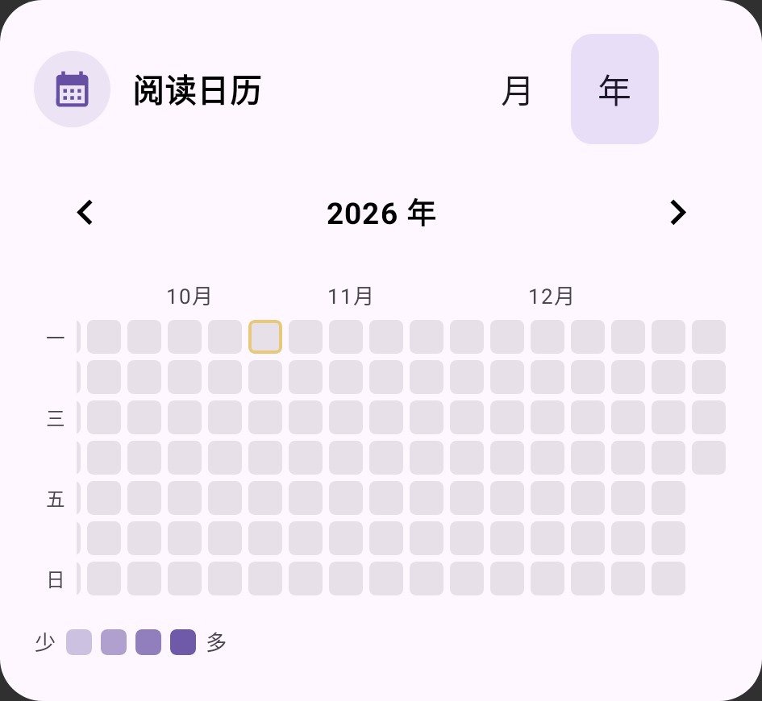
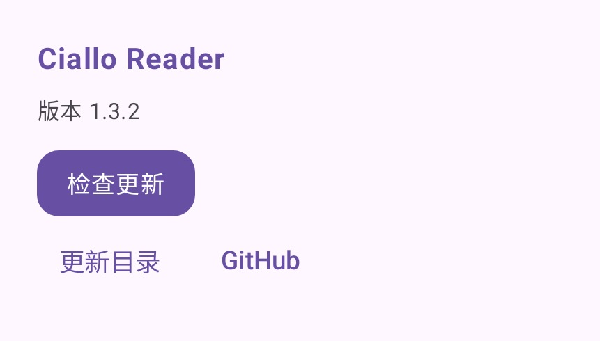
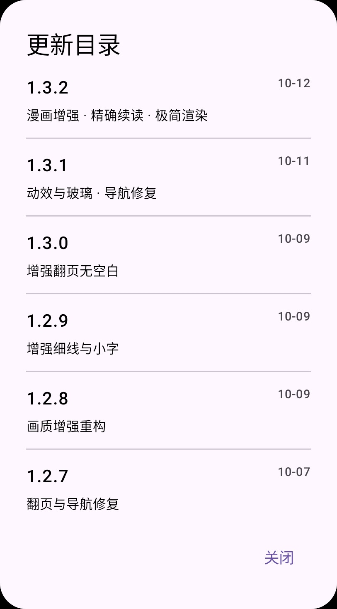

# Ciallo Reader 1.3.2

版本：1.3.2 / 213。Android 7.0+，arm64-v8a。

## 改动

- MangaJaNai：真实 V1 2x 1200p ESRGAN 模型，首次选择按需下载约 64 MiB；下载进度、校验失败与重试可见。复用已有 ONNX Runtime，不增加另一套原生推理库。
- 合并旧 WAIFU2X 到“超分”，自动迁移强度；删去不再调用的旧滤镜实现。保留锐化、线条与超分三个直接可用的选项。
- 漫画按书籍和稳定章节 ID 保存页码；条漫、连续滚动保存首可见页和页内像素偏移，图片真实高度到达后再恢复位置。图片 URL、请求头更新不重置页码；退出和后台切换立即保存。
- 新增“极简”渲染档，保留既有档位 ID，旧安装设置兼容。关闭玻璃采样、卷页、装饰动画、漫画增强和滤镜、翻译及场景音效；平面卡片和基本控件直接渲染。
- 精简设置和漫画面板说明、重复英文副标题；软件信息卡按名称、版本、更新操作分主次。更新目录用短句，使用统一弹窗进入、退出动效，极简和减少动态效果时直接切换。
- 搜索关键词卡折叠箭头朝右、展开朝下；月历与年度热力图保持方格，年度横纵间距统一。月份行增加高度并明确行高，修复“9 月 / 11 月”等标签裁切；左侧星期标签固定。

## 内存控制

MangaJaNai 单线程 CPU 推理，每次只处理一页；48 px 核心块加两侧 16 px 边缘，推理输入固定为 80×80，复用 RGB 缓冲。模型从文件路径创建会话，避免额外的 64 MiB Java 字节数组；关闭 CPU arena 和内存模式缓存，单页完成或取消后关闭原生会话。输出限制长边 3200 px、约 400 万像素，直接合成结果，不创建整页 2x 中间图。处理结果写入磁盘，重读优先复用。

MangaJaNai 主结果内存缓存限制为 20 MiB。极简档限制主缓存 12 MiB、解码长边 1600 px、单路解码；缩小缩略图、区域解码和预览缓存，关闭 Coil 重复内存缓存及下一话预取。

MangaJaNai 仅对可见页执行增强；相邻页最多保留四张 480 px 原图预览，供卷页过渡使用，避免后台增强占用内存。极简档不预取相邻页。

上述是实现中的资源限制，不是整机峰值测量。约 64 MiB 权重、原生引擎与运行中间值仍需内存；低内存设备建议极简档。分块推理会牺牲速度，首次处理大页可能较慢；阅读先显示原图，失败可重试。

## 模型验证

固定模型 SHA-256 与修订见 [来源及许可](vendor-licenses/MangaJaNai/README.md)。`tools/verify-mangajanai.py` 已使用真实 ONNX 文件在桌面 CPU 验证 6 个固定尺寸块：96×128 输入合成 192×256 输出，全部数值有限，输出与最近邻放大存在差异。该样例只验证模型和分块管线能执行，不是漫画质量评分或 Android 性能评测。

未连接 Android 设备，未做真机安装、峰值内存或帧率测量，不能保证任意旧设备流畅程度。

## 界面核对

以下为 Robolectric 360 dp 界面截图，使用极简档与测试数据：月份文字完整，年度格子为正方形且间距一致；软件信息卡和更新目录保持简短。

| 阅读日历 | 软件信息 | 更新目录 |
| --- | --- | --- |
|  |  |  |

## 构建验证

- 49 个套件、359 项 JVM / Robolectric 回归通过；失败 0、错误 0、跳过 0。测试类采用独立 JVM，避免 Compose / Robolectric 状态跨套件污染。
- Release 构建、R8 与资源精简通过；Android 设备测试代码编译通过。
- APK 版本 1.3.2 / 213，仅 arm64-v8a，24,157,449 字节。ZIP CRC、16 KiB ZIP 对齐与签名验证通过。
- 沿用 1.3.1 签名证书，可以覆盖安装；SHA-256：`2aba706731e26cde0e291568a3eb6d6894df1c8fac7b8fdcd18cfdbc18c97c7d`。
- 832 个构建输入已在构建前后核对，发布提交与这些输入一致；APK 内许可与模型资源逐字节核对。
