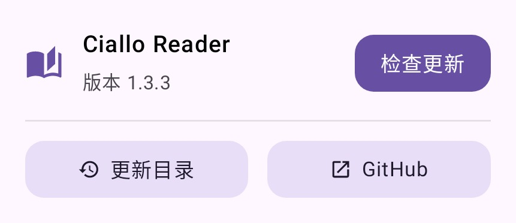
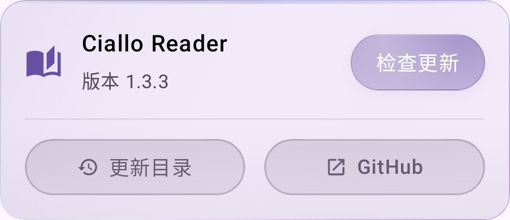

# Ciallo Reader 1.3.3

版本 1.3.3 / 214，Android 7.0+，arm64-v8a。

## 设置卡片

软件信息沿用设置页的 GlassCard、16 dp 内边距、24 dp 图标与 15 sp 行标题。名称和版本在左，主要更新操作在右；下方两个等宽入口均采用 AppActionButton 的同一尺寸、同一变体，修复之前实心按钮和原生文字按钮混排的问题。极简档使用同一布局的平面控件，默认高画质档使用现有玻璃组件。

## MangaJaNai 执行优化

保留原 V1 1200p ESRGAN ONNX 文件及 SHA-256、FP32 权重、输入分辨率、48 px 核心块、16 px 边缘、强度混合和输出尺寸限制。没有使用轻量替代模型、量化、FP16 relaxation 或缩小输入来达成速度指标。

- 开启 ONNX Runtime 图优化、固定符号尺寸、内存规划与工作区复用；CPU 最多 4 个线程，禁止空闲自旋。
- 直接缓冲、输入 Tensor 和固定输出 Tensor 在每页分配一次；每个块复用 pinned output，避免反复构造张量与拷贝整个输出块。
- 单个推理会话跨页复用，空闲 15 秒、退出阅读或内存压力时释放。缓存模型的长度和修改时间，文件未改变时不反复读取 64 MiB 校验；下载或文件变化仍执行完整 SHA-256 校验。
- 首次按实际设备比较优化 CPU、XNNPACK、NNAPI 的相同图块耗时和输出。硬件候选只有至少快 15%，且最大浮点误差 ≤0.0015、平均误差 ≤0.0001 时才采用。NNAPI 限 Android 10+，禁用其参考 CPU 路径，不开启 FP16。选择按系统构建指纹与模型版本保存；运行时失败重试同一块的优化 CPU。
- 仍只增强可见页，保持原图过渡和现有结果缓存；不把预生成或磁盘命中的图片作为新推理耗时。

这种优化会保留更久的权重和有限工作区，用少量额外驻留内存换取速度。极简档仍关闭增强。未做手机峰值内存测量。

依据：[ONNX Runtime NNAPI](https://onnxruntime.ai/docs/execution-providers/NNAPI-ExecutionProvider.html)、[XNNPACK](https://onnxruntime.ai/docs/execution-providers/Xnnpack-ExecutionProvider.html)、[固定输出 Tensor API](https://onnxruntime.ai/docs/api/java/ai/onnxruntime/OrtSession.html)。

## 速度和质量验证

桌面 CPU、真实模型、300×450 合成测试样图、70 个原尺寸块，包含会话创建、输入组织、全部推理与结果拼接，排除 PNG 写盘：

| 执行方式 | 总耗时 | 与原输出最大浮点误差 | 平均浮点误差 |
| --- | ---: | ---: | ---: |
| 1.3.2：单线程，无图优化 | 59.13 s | 0 | 0 |
| 优化 CPU：4 线程、图优化、固定输出复用 | 11.95 s | 0.00000143 | 0.000000195 |

约提速 4.9 倍。测试期间还有构建任务，数字仅表示本次桌面样例，不是手机性能结论。这个 300×450 样图也未达到 5 秒；不能把它外推成普通漫画整页 5 秒达标。

复现：`python tools/benchmark-mangajanai.py MODEL.onnx REPORT_DIR --image PAGE.png`。不指定图片时明确使用 300×450 合成样图。

尚未连接 Android 真机。设备测试 `MangaJaNaiPerformanceDeviceTest` 会对默认 1200×1800 输入连续执行两遍真实增强，分别记录冷启动和会话复用后的整页耗时，明确输出 `within5Seconds`。先在应用中下载模型，运行时可用 `mangaWidth`、`mangaHeight` 参数指定尺寸；日志标签为 `MangaJaNaiBenchmark`，后端日志为 `MangaJaNai`。该测试不以磁盘命中替代推理，也没有把 5 秒目标写成已通过的断言。

## 界面截图

Robolectric 360 dp 测试界面，验证同一布局的极简和高画质档：

| 极简 | 高画质 |
| --- | --- |
|  |  |

## 构建验证

- 50 个套件、362 项 JVM / Robolectric 回归通过，失败、错误和跳过均为 0。使用独立测试进程；新增测试覆盖高画质 / 极简卡片布局与更新目录、错误硬件输出拒绝。
- Android 设备测试代码编译通过，未连接手机执行原生加速或整页速度测试。
- Release / R8 / 资源精简通过；APK 24,161,261 B，签名、ZIP CRC、16 KiB ZIP 对齐验证通过。
- 签名证书与 1.3.2 相同，可以覆盖安装。SHA-256：`f2800f5f1147455f35c4c3247c9f2377af1a9c3b96c1ce77a6308d6e2330a3e6`。
- 835 个构建输入在构建前后核对，并与发布提交核对；资源和许可逐字节验证。
