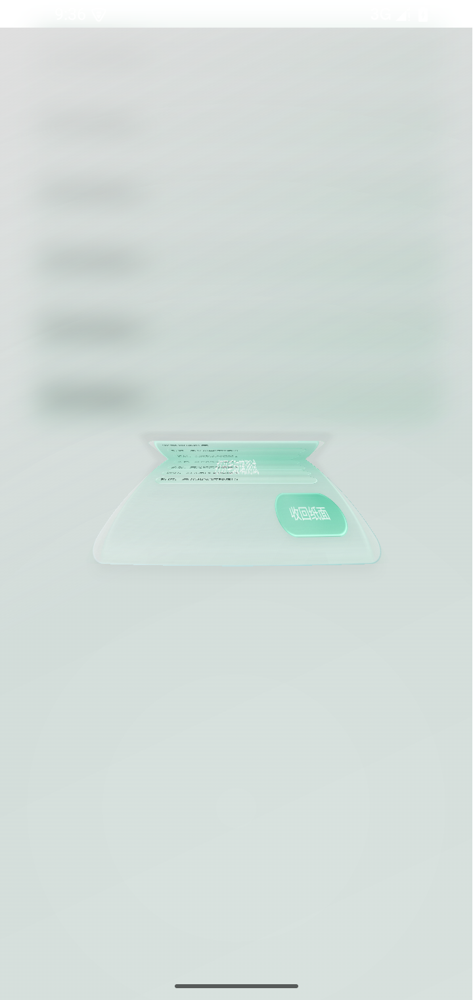
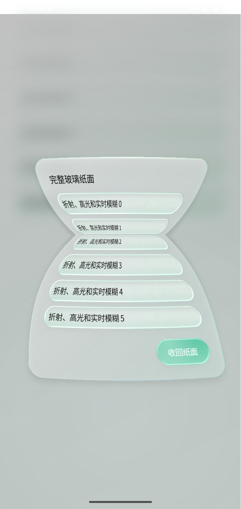

# Ciallo Reader 1.4.13 · 2026-10-21

版本 **1.4.13 / 236**，沿用正式发布签名，可覆盖升级 1.4.12。

## 修复与打磨

- **滑动条不再误跳**：按下时先判断手势意图，纵向滚动经过轨道不改值，确认横向拖动或有效轻触后才更新；固定活动指针，多指不会接管滑块。轻触正在回弹的透镜不再把数值倒拉。
- **保留完整抽纸效果**：移除连续慢帧后的阴影削减和全局普通过渡标记。继续使用 26 × 150 连续网格、同一组开合弹簧、玻璃折射、高光、轮廓阴影及随纸面变形的文字。
- **减少前端计算**：分离玻璃来源和消费者，避免自采样循环；每个实际窗口隔离玻璃坐标，同窗嵌套复用来源。按钮显示列表按需捕获、GPU 纹理读回串行、已有软件纹理直接复用、透明裁边向内扫描；网格直接写浮点数组，避免每个顶点的坐标打包与拆解，列基函数复用。滑动条曲线每帧只生成一次并供所有透镜重绘。
- **离屏读取完整纸面**：Android 10 起通过 HardwareRenderer / ImageReader 提交离屏渲染，后台处理像素；截图目标缓存复用并在空闲后释放。压缩、阴影和文本仍来自完整纹理，不因慢帧切换为普通过渡。混色只分配纸面实际覆盖区域，零贡献纹理不提交绘制。
- **改善开合衔接**：按钮与窗口纹理互补混合，避免过渡中段额外变暗；收回前更新按钮的实际按压状态。按压缩放与透明度一起进入来源纹理，避免接管时亮度跳变。关闭完成、旧窗口退场后才执行下一步，后续窗口重新绑定仍然存在的来源。
- **拖动持续跟手**：手指移动只改变弹簧目标，不重启动画时钟；静止后停止帧循环。开始拖动前冻结当前内容，避免闪回旧加载画面；初始可见的嵌套内容随父纸面一次捕获，后续展开和收起仍使用纸面动画。
- **补齐入口**：发现的书源选择、分类和长按，以及目录、书签、源组、书架选择面板等动作统一经过来源登记与关闭生命周期。
- **单一顶部栏**：手册与缓存管理只保留原有标题栏和一个关闭按钮；自定义标题栏仍支持拖动回弹和收回。

用户主动开启的减少动态效果 / 极简画质，以及真实不支持硬件画布的窗口，保留兼容路径；正常支持的设备不会因为慢帧被自动降级。

## 验证

- 24 项相关 JVM 用例分批通过；最终只复验受改动影响的几何、像素打包和关闭器 3 项检查。[记录](../artifacts/paper-1.4.13/jvm-results.json)
- 5 项原生故障用例分批通过；末轮只复验变化的两项。覆盖连续八次毛玻璃开合、开场中断和再次打开、发现来源与退出后选择、手册 / 缓存单头栏与拖动、滑条纵向滚动与横向调节。[记录](../artifacts/paper-1.4.13/native-results.json)
- 八次开合：**32 次异步读取、0 旧后端回退、0 捕获失败、0 动效降级**；337 帧网格期间正文仅绘制 32 次。[采样](../artifacts/paper-1.4.13/device/dense-glass.txt)
- 手册 / 缓存 10 次读取、发现 4 次读取均为异步，回退为零；后续操作等旧窗口销毁才执行。

滑动条优化前后的浅色、深色静态渲染样图逐像素一致，最大通道差均为 **0**。检查记录：[像素比对](../artifacts/paper-1.4.13/slider-visual-diff.json)。

UI gate 保持原基线并通过；书架结构审计 68 项通过。工程说明同步更新，723 个源码文件全部覆盖，三项旧文件均明确标记为已删除。

实际窗口展开与收回截帧：

| 展开 | 收回 |
| --- | --- |
|  |  |

[手册单头栏](../artifacts/paper-1.4.13/device/manual-one-header.png) · [缓存单头栏](../artifacts/paper-1.4.13/device/cache-one-header.png)

未重复无关全量套件。未连接实体 ARM64 手机，模拟器数据不能代替所有厂商 GPU 的帧率。

## 安装包

[下载 ARM64 APK](https://github.com/roxycon-dev/Ciallo-Reader/releases/download/v1.4.13/Ciallo-Reader-v1.4.13.apk) · [校验文件](https://github.com/roxycon-dev/Ciallo-Reader/releases/download/v1.4.13/SHA256SUMS.txt)

- 版本：**1.4.13 / 236**；包名 `com.aistudio.novelreader.kxmpzq`。
- 大小：**29,168,760 B**；正式签名、与 1.4.12 同证书且版本码递增，覆盖升级条件通过。
- ARM64 单架构、ZIP CRC、16 KiB 对齐通过；716 项生产输入与冻结源码一致。
- SHA-256：`172f74884c2abc16c7c4eec84c5e3e7ad0a0ddedf0fbbb9131e86771a56daf3d`。

[包身份记录](../artifacts/paper-1.4.13/release-identity.json)

保留 1.4.12 的原生自由卷页、默认分区与书源修复；本轮没有改动数据库、阅读进度或用户设置格式。
