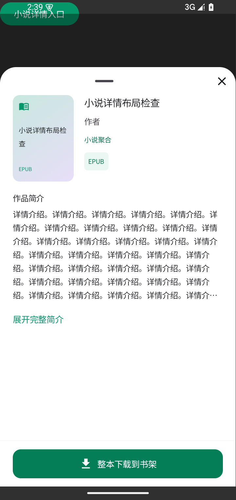

# Ciallo Reader 1.4.16 · 动效衔接与平稳落定

本版保留 1.4.15 的柔性纸面与玻璃外观，重点打磨按钮进入新界面的衔接。

- **直接进入管理界面**：在书源选择中点击管理，新界面直接从管理按钮展开。旧选择窗口不会先收回，原页面和底栏也不参与收回。
- **共用且适合动作的过渡**：完整页面、底部面板、弹窗和菜单使用同一来源与生命周期封装；关闭、确认、向前跳转分别处理。向前跳转冻结真实点击位置，防止旧窗口销毁导致入口失效；返回使用仍存在的上级入口。
- **平稳落定**：调整展开弹簧，消除铺平后又突然变形的迟发回弹。展开期间仍保留收口、释放、轻弯和飘动；关闭使用原来更快的独立吸回弹簧。
- **底部内容完整显示**：修正共用弹层的物理窗口边界与系统安全区，避免整屏内容被状态栏向下推移后超出屏幕。居中弹窗、底部面板和菜单避让系统栏与输入法；小说详情的“整本下载到书架”等按钮不再被裁掉下半部分，公共按钮与小说操作按钮可随字体增高。
- **缓存管理打磨**：缓存明细移除独立缩放 / 淡入，让内容和纸面一起运动；普通关闭与确认操作仍等待关闭完成并去重。

仍采用普通 Compose 图层内的一次 GPU 内容采样；没有恢复截图回读、额外离屏渲染器或隐藏来源卡片。Android 13 以下、降低动态效果和不支持 shader 的设备沿用已有稳定过渡。

27 项相关 JVM 检查通过，覆盖展开平稳落定、来源冻结、反转和确认 / 前进操作顺序；随后窗口边界与按钮高度修改由 5 项相关设备检查覆盖，没有重跑无关全量测试。

设备检查包含书源选择到完整页面的交接、原底栏位置、真实管理页面与单次导航、缓存入口 / 明细、小说详情物理安全区，以及 2 倍字体下普通 / 极简两条按钮路径。最后修正非整页宿主的窗口类型判断后，仅重跑受影响的 3 项检查并全部通过。

修复前，小说下载文字的物理下边界为 1514px，超过 1478px 的导航安全边界；修复后为 1430px，文字行高完整 39px，窗口屏幕偏移从 42px 归零。缓存链路 200 次图层变形更新，shader 失败 0；这不是帧率或总 GPU 耗时测试。

原 UI gate 基线通过；工程说明覆盖 722 个源码文件，遗漏 0。详细范围和中间发现见 [专项结果](../artifacts/paper-1.4.16/targeted-results.json)。

正式 Release 构建完成，1.4.16 / 239，ARM64，29155684 B。与 1.4.15 同包名、同固定签名且版本码递增；ZIP CRC 和 16 KiB 对齐通过，715 个生产输入与冻结清单匹配。SHA-256：`4347e5c95bb7ab1bba47bb978801a246bd3e11cfd89ae5c729ab2d7c1fb94ff7`。

[下载 1.4.16 APK](https://github.com/roxycon-dev/Ciallo-Reader/releases/download/v1.4.16/Ciallo-Reader-v1.4.16.apk)。
