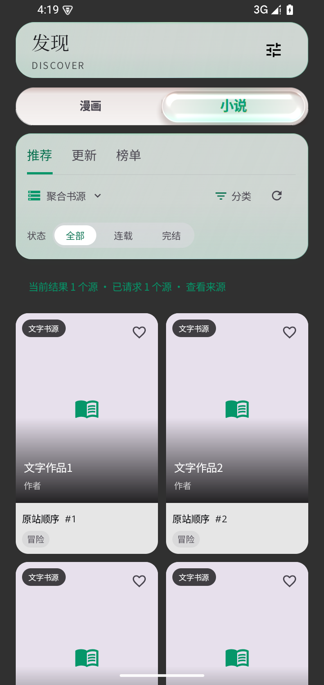
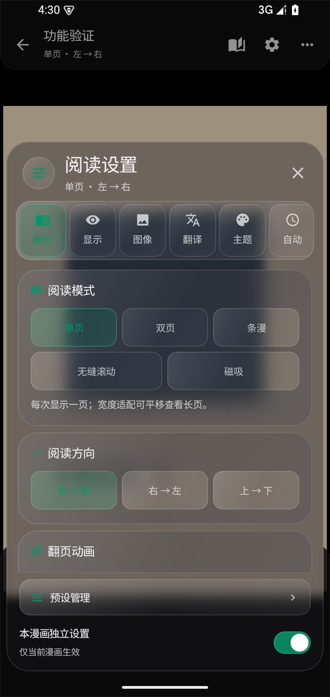

# Ciallo Reader 1.4.17

小说与漫画现在拥有相互独立的发现分区。推荐 / 更新 / 榜单卡片上方使用应用现有的水滴选择条；卡片、来源选择、分类和发现设置沿用原界面，两边分别保存书源、布局、筛选、屏蔽、滚动位置和离线内容。

小说发现读取原站真实推荐、分类与更新列表，适配全本、话本、SF、番茄、爱下、书阁、Wenku8 Library、Novelia，以及自定义原生 explore 和静态 Legado 发现规则。某个源没有提供的榜单或时间范围会如实提示；不会拿搜索结果冒充推荐或填造热度。小说卡片进入共用详情、下载和本地阅读流程。

设备互传与备份、图书、章节目录、本地及在线阅读、完整设置页等页面入口也接入统一抽纸宿主；参数、弹簧、按钮定位和返回时序均由公共封装处理。阅读页继续使用 Activity 原窗口，保留亮度、沉浸模式、音量键和进度保存流程。神回编辑本身已有原生弹层，继续仅使用那一层动效。

阅读器打开设置时，工具栏保留在遮罩后，减少多处同时变形。漫画设置、目录和预设对实际面板变形；关闭期间持续保留玻璃采样，移除提前撤掉背景的固定计时器。从三点菜单进入设置，返回位置改变不再导致整个设置内容重建。已经展开的页面重新进入内联面板时也能正常启动独立的抽纸。返回图书页后仍保留原始起点与再次吸回能力，不会误用退出阅读按钮。

漫画原生 SurfaceView 不接受 Compose 形变，页面转场期间改为绘制相同的已处理页面像素，转场完成后继续使用原引擎；不截图回读、不隐藏来源卡片、不新增离屏渲染器。

## 本轮验证

本轮 68 项不同的相关 JVM 检查通过：首轮 67 项，新增章节小说路由 / 封面头部用例后，仅补查小说协议 6 项。最终漫画面板保留和按钮起点修改，由真实阅读器设备用例覆盖，没有重复全量测试。补充返回原始按钮断言后，只重查对应完整页面用例并通过。

5 项设备用例通过：完整页面参数与返回、水滴分区、菜单到设置的内容保持、静止父页面的内联面板，以及真实漫画设置中自动阅读 / 音量键在实际关闭结束后才恢复。截图已目视检查；所选路径 shader 失败 0，不能等同所有设备的帧率保证。

原 UI gate 基线通过；工程说明覆盖 727 个源码，遗漏 0。详见 [专项记录](../artifacts/paper-1.4.17/targeted-results.json)。

正式构建完成：1.4.17 / 240，ARM64，29176268 B。与 1.4.16 同包名、同固定签名且版本码递增，ZIP CRC / 16 KiB 对齐通过，718 个生产输入与冻结清单匹配。SHA-256：`b1c9bff50095b50948393a5380798170f891564cc11990e5d76aab2c79697996`。

[下载 1.4.17 APK](https://github.com/roxycon-dev/Ciallo-Reader/releases/download/v1.4.17/Ciallo-Reader-v1.4.17.apk)。
