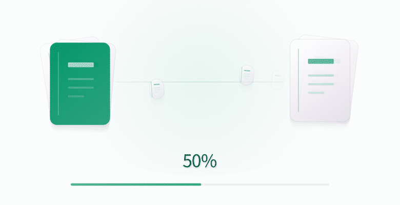

# Ciallo Reader 1.4.3 · 2026-10-18

将数据备份升级为「设备互传与备份」，新增按类别发送、便携数据包和合并导入；重做卡片流转动效，删除口号、装饰英文和重复提示。

## 更新内容

- 入口：设置 → 设备互传与备份。提供发送、接收、分享数据包、本地备份和历史记录。
- 实现同 Wi-Fi／热点 NSD 发现和附近 Wi-Fi Direct；双方核对六位校验码并确认后，通过 TLS 发送数据。无需账号、手填 IP 或谷歌服务。
- 按 1MiB 分块，校验分块及完整包的 SHA-256；保存确认偏移，断线自动重试后提供手动续传，保留临时文件 24 小时。正在传输的任务使用前台服务与取消通知。
- 统一 v2 `.ciallo` 数据包，兼容旧 ZIP；系统分享及文件打开进入同一套检查、预览和导入流程。
- 默认合并，保留本机元信息、设置和同标识书源，阅读进度取最近时间；稳定身份、导入收据与阅读会话去重，避免重复导入和往返重复累计时长。
- 整机迁移需要额外确认，保存最近一次迁移的回退快照；数据库 v12 非破坏性升级至 v13，导入日志协调数据库、设置、资源与书源提交，失败回滚。
- 受保护内容默认排除，本机 PIN 验证后可以加入；接收机设置自己的保护方式。PIN、Cookie、登录状态和 API 密钥不迁移。
- 动效采用层叠卡片、文件流转、实际阶段进度与完成收束；适配关闭动画和后台停止装饰动画。字节传完后继续展示校验与导入阶段。

## 验证范围

39 项选定自动测试全部通过：

| 测试范围 | 数量 |
| --- | ---: |
| v2／旧 ZIP、合并、去重、保护、设置、统计及回滚 | 14 |
| 分块回环、损坏／截断消息与权限策略 | 4 |
| Compose 布局、阶段截图与动效帧 | 3 |
| 数据库升级 | 2 |
| 现有收藏分享回归 | 16 |

Release 构建、R8、Vital Lint 和固定证书校验通过。UI gate 指标未新增退步；原有 fontLiteral 524/522、spLiteral 622/619 超限仍存在，不能将全局 UI gate 记为通过。

**当前工作环境没有连接测试手机。** 两台不同品牌 Android、无谷歌服务环境、同 Wi-Fi／热点／Wi-Fi Direct、后台与进程重启续传，以及微信／QQ／系统分享的冷启动接收尚待真机验证。自动测试和界面预览不代表这些无线链路已完成验收。

以上为 Compose 状态帧生成的界面演示，不是真实双机传输录屏。

## 安装

版本 1.4.3，versionCode 226，Android 7.0+，arm64-v8a。沿用固定发布证书，包名不变，满足从 1.4.2 保留数据覆盖升级的包标识、证书和版本条件；未执行真机覆盖安装。

APK 大小：29,065,083 B。SHA256：`f55500aa95f4372f8ad8edf211bcb15acedbda8964116728920d41a9c9920e04`。

- [下载 APK](https://github.com/roxycon-dev/Ciallo-Reader/releases/download/v1.4.3/Ciallo-Reader-v1.4.3.apk)
- [SHA256SUMS](https://github.com/roxycon-dev/Ciallo-Reader/releases/download/v1.4.3/SHA256SUMS.txt)
- [使用与实现说明](device-transfer.md)
- [GitHub Release](https://github.com/roxycon-dev/Ciallo-Reader/releases/tag/v1.4.3)
